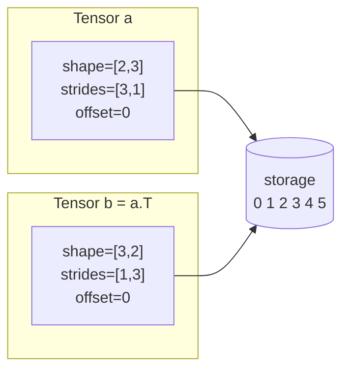
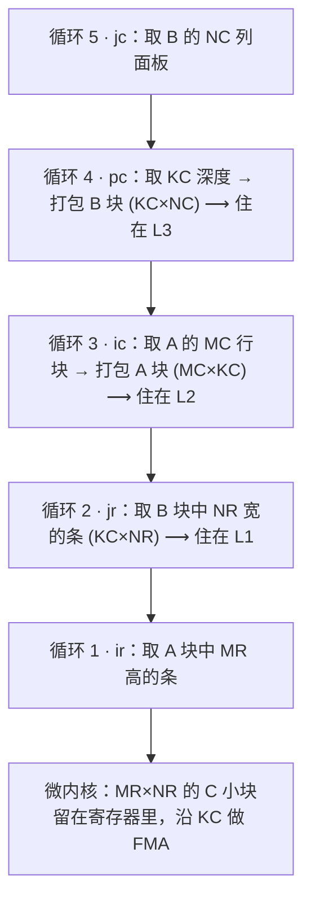
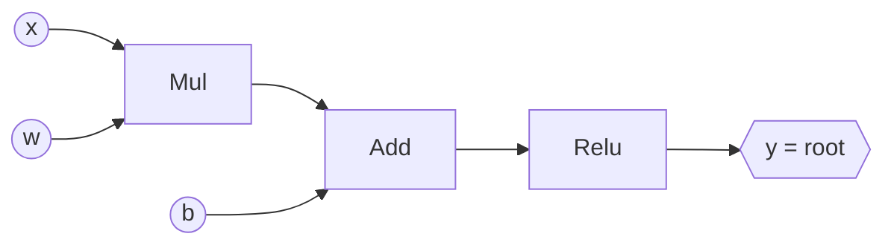

# L0 张量、内存与 CPU 性能

[← 课程大纲](../syllabus.md) · 配套实验：[lab0 minitensor](../../labs/lab0/README.md) · 下一讲：[L1 GPU 执行模型与 CUDA GEMM](L1-cuda-gemm.md)

> [!abstract] 这一讲要解决的三个问题
> 1. **一个张量在内存里到底长什么样？** 为什么转置、切片、广播都可以“免费”完成？
> 2. **为什么同样的数学运算，速度能差 100 倍？** 怎样判断一个程序被什么卡住，又能快到什么程度？
> 3. **深度学习编译器在做什么？** 算子融合到底省下了什么？前沿的编译器（Mirage、megakernel）又往前走了多远？
>
> 这三个问题贯穿整门课：L1 把问题 2 搬到 GPU 上，L2、L3 把问题 3 做到极致。

**学习方式**：本讲分四节，每节 45–60 分钟。读完一节就去做对应的 lab 部分，不要一口气读完再动手。每节末尾有自测题，答案默认折叠，先自己想再展开。

| 节 | 内容 | 对应 lab |
|---|---|---|
| §1 | 张量 = 存储 + 元数据 | Part A：A1–A3 |
| §2 | 视图、广播与“什么时候会复制” | Part A：A4–A9 |
| §3 | CPU 性能：缓存、Roofline 与 GEMM 优化阶梯 | Part B |
| §4 | 从 eager 到图：算子融合与深度学习编译器 | Part C |
| §5 | 从基础到前沿：演进脉络与延伸阅读 | 研究选题参考 |

---

## §1 张量 = 存储 + 元数据

### 1.1 内存是一维的

无论张量有几维，内存都只是一长串地址。一个 2×3 的矩阵：

```
logical view (in your head)          physical storage (in memory)
        col0 col1 col2
row0  [  0    1    2  ]         storage: [ 0 | 1 | 2 | 3 | 4 | 5 ]
row1  [  3    4    5  ]          index:    0   1   2   3   4   5
```

把逻辑位置 `(i, j)` 映射到存储下标的规则，就是张量的**布局**。最常见的是**行优先**（row-major，也叫 C order），同一行的元素在内存里挨在一起。

### 1.2 Stride：每一维“走一步”跳多远

**stride[d]** 的意思是：第 d 维的下标加 1 时，存储下标要跳过多少个元素。上面那个矩阵：

- 沿行方向（第 0 维）走一步，要跳过一整行，即 3 个元素，所以 `stride[0] = 3`；
- 沿列方向（第 1 维）走一步，跳到相邻元素，所以 `stride[1] = 1`。

于是有一个通用公式：

$$
\text{storage\_index}(i_0, i_1, \dots) = \text{offset} + \sum_d i_d \cdot \text{stride}[d]
$$

验算：`(1, 2)` → `0 + 1×3 + 2×1 = 5`，存储里第 5 个元素正好是 5。✓

**行优先 stride 的算法**（lab A1）：最后一维的 stride 是 1，往前每一维都是后一维的 stride 乘以后一维的大小。

```
shape   = [2, 3, 4]
strides = [3x4, 4, 1] = [12, 4, 1]
```

所以，一个张量 = **一块共享的存储** + **shape、strides、offset 三样元数据**。PyTorch 的 `Tensor`、NumPy 的 `ndarray` 都是这样设计的，你在 lab A 里写的 `mt::Tensor` 也一样。



> [!tip] 立刻动手
> 打开 [Stride Visualizer](https://ezyang.github.io/stride-visualizer/index.html)，把 shape 设为 `[2,3]`、stride 设为 `[3,1]`，然后把 stride 改成 `[1,2]`，观察逻辑格子映射到的存储格子怎样变化。这个工具只演示地址映射，不模拟缓存。

### 1.3 连续（contiguous）是什么意思

如果按逻辑上的行优先顺序遍历所有元素，存储下标恰好是 `offset, offset+1, offset+2, …`，中间没有空洞、没有回跳，这个张量就是**连续的**。

一个容易漏掉的细节（lab A3 会考）：**大小为 1 的维度，stride 是多少都无所谓**，因为你永远不会沿它走第二步。所以 shape `[1, 3]`、stride `[99, 1]` 的张量依然是连续的。

> [!question]- 自测 1.1：shape `[4, 5]` 的行优先张量，元素 `(3, 2)` 的存储下标是多少？如果从这块存储里取 offset=6、shape=[2,2]、strides=[5,1] 的视图，它包含哪些下标？
> strides = [5, 1]，所以 `(3,2)` → 3×5 + 2 = **17**。视图包含 6, 7, 11, 12，也就是原矩阵第 1–2 行、第 1–2 列组成的子块。子块不连续：7 和 11 之间隔了 3 个元素。

> [!question]- 自测 1.2：为什么 PyTorch 要用 stride 这种“间接”的设计，而不是每个张量都老老实实存一份连续数据？
> 因为大量操作（转置、切片、`expand`、`view`、`squeeze` 等）只需要改元数据，花费是 O(1)，而不是 O(N) 的复制。深度学习程序里这类“改形状”的操作非常多，全部复制会浪费大量时间和内存。代价是：底层算子必须能处理任意 stride，或者在需要时先调用 `contiguous()`。

---

## §2 视图、广播与“什么时候会复制”

### 2.1 视图操作只改元数据

| 操作 | 新 shape | 新 strides | 新 offset | 复制吗 |
|---|---|---|---|---|
| `transpose(0,1)` | 交换两维 | 交换两维 | 不变 | 否 |
| `permute(order)` | `shape[order[i]]` | `strides[order[i]]` | 不变 | 否 |
| `slice(d, start, stop, step)` | `ceil((stop-start)/step)` | `strides[d] × step` | `+ start × strides[d]` | 否 |
| `broadcast_to(target)` | target | 被拉伸的维度设为 **0** | 不变 | 否 |
| `view(new_shape)` | new_shape | 行优先 strides | 不变 | 否，但要求原张量连续 |
| `contiguous()` | 不变 | 行优先 strides | 0 | **是**（已经连续时直接返回自己） |

一个切片例子：`arange(12).view({3,4})` 取第 1 维的 `1:4:2`，也就是第 1、3 列：

```
original: shape=[3,4] strides=[4,1]     slice: shape=[3,2] strides=[4,2] offset=1

   0  1  2  3                               1  3
   4  5  6  7          ------->             5  7
   8  9 10 11                               9 11

storage: [ 0 |*1*| 2 |*3*| 4 |*5*| 6 |*7*| 8 |*9*|10 |*11*]   *x* = reachable from the slice
```

### 2.2 广播：stride 为 0 的魔法

NumPy 的广播规则只有一条：**两个 shape 从右往左对齐，每一对要么相等，要么其中一个是 1**；缺失的维度当作 1。

```
a:      [3, 1, 5]
b:         [4, 5]      -> padded on the left to [1, 4, 5]
result: [3, 4, 5]
```

实现上，把大小为 1 的维度“拉伸”成 n，只需把它的 stride 设成 **0**：沿这一维无论走多少步，地址都不变，读到的永远是同一个元素。

```
row = [1, 2, 3]   shape=[3] stride=[1]
row.broadcast_to([4, 3])  ->  shape=[4,3] strides=[0,1]

logical view         storage index read
[1 2 3]              0 1 2
[1 2 3]              0 1 2     <- every row points at the same memory
[1 2 3]              0 1 2
[1 2 3]              0 1 2
```

所以 `x + bias`（`x` 的 shape 为 [B, D]，`bias` 的 shape 为 [D]）不需要先把 bias 复制 B 份。lab A8 的 `zip` 就是这样做的：先把两个输入都广播成视图，再逐元素计算。

### 2.3 什么时候必须复制

- **底层 kernel 要求连续输入**：比如 BLAS 要求每一行内部连续。lab 里 `mt::matmul` 会先对两个操作数调用 `contiguous()`。
- **`view` 一个不连续的张量**：`x.T.view(-1)` 会报错，因为按新 shape 的行优先顺序，没法用一组 stride 描述原来的元素顺序。`reshape` 会在必要时自动复制。
- **写入广播视图**：stride 为 0 意味着多个逻辑位置共享同一个存储元素，写一个会改所有。PyTorch 会拒绝这种写入。

> [!warning] 性能陷阱
> 不连续的张量本身不慢，**访问模式**才决定速度。按行遍历一个转置视图，等于按列遍历原矩阵，每次跳 `stride` 个元素，缓存行几乎没法复用。§3 会量化这件事。

> [!question]- 自测 2.1：`x` 的 shape 是 [8, 1, 6]，`y` 的 shape 是 [7, 1]。`x * y` 的结果 shape 是什么？y 广播后的 strides 是什么（假设 y 原本连续）？
> 对齐：`[8,1,6]` 与 `[1,7,1]` → 结果 **[8, 7, 6]**。y 原 strides 为 `[1,1]`（shape [7,1]，最后一维大小为 1，按行优先是 [1,1]）。广播后：新增的第 0 维 stride 为 0；第 1 维 7==7，保留 1；第 2 维从 1 拉伸到 6，stride 为 0。结果是 **[0, 1, 0]**。

> [!question]- 自测 2.2：`sum(x, dim=1, keepdim=True)` 和 `keepdim=False` 有什么区别？为什么 softmax 实现里常用 `keepdim=True`？
> keepdim=True 时，被归约的维度保留为大小 1，于是结果能直接和原张量广播：`x / x.sum(-1, keepdim=True)`。keepdim=False 会删掉那一维，再想广播就要手动 `unsqueeze`。lab 里 `A_capstone_softmax_from_views` 用的就是这个技巧。

**延伸阅读**：Edward Z. Yang 的 [PyTorch internals](https://blog.ezyang.com/2019/05/pytorch-internals/) 前半部分用图解释了 storage、stride、view，与本节内容一一对应（文中的内部类名较旧，概念没有变化）。

---

## §3 CPU 性能：缓存、Roofline 与 GEMM 优化阶梯

### 3.1 先算出“天花板”：峰值 FLOP/s

现代 CPU 核心每个时钟周期能做多少次浮点运算？

$$
\text{峰值 FLOP/s} = \text{主频} \times \text{FMA 单元数} \times \text{SIMD 宽度（float 个数）} \times 2
$$

最后的 ×2 是因为一条 FMA（fused multiply-add，`a*b+c`）算作 2 次浮点运算。

| CPU 核心 | 主频 | FMA 单元 | SIMD 宽度 | 单核峰值 |
|---|---|---|---|---|
| Intel Alder Lake P 核（AVX2） | ~4.7 GHz | 2 | 8（256 bit） | ~150 GFLOP/s |
| Apple M1/M2 性能核（NEON） | ~3.2–3.5 GHz | 4 | 4（128 bit） | ~100–110 GFLOP/s |
| AMD Zen 4（AVX-512，双发射 256 bit） | ~5 GHz | 2 | 8 | ~160 GFLOP/s |

具体数值按你自己的 CPU 型号查（Intel ARK、Apple 规格页，或 [Agner Fog 的微架构手册](https://www.agner.org/optimize/microarchitecture.pdf)）。lab B0 要求你算出自己机器的这个数字。

### 3.2 内存层次：数据搬运才是真正的瓶颈

| 层级 | 典型容量 | 延迟 | 单核带宽量级 |
|---|---|---|---|
| 寄存器 | 16 个 256-bit YMM（AVX2）/ 32 个 128-bit（NEON） | 0 周期 | — |
| L1 数据缓存 | 32–64 KB / 核（Apple 128 KB） | ~4–5 周期 ≈ 1 ns | ~200+ GB/s |
| L2 缓存 | 1–2 MB / 核（Apple 是多核共享的十几 MB） | ~14 周期 ≈ 3 ns | ~100 GB/s |
| L3 缓存 | 十几到几十 MB，多核共享 | ~40–70 周期 ≈ 10–20 ns | ~50 GB/s |
| DRAM | GB 级 | ~80–100 ns | 单核 ~10–30 GB/s，全核 ~50–100 GB/s |

两个必须记住的事实：

1. **缓存以“缓存行”为单位搬运**，x86 上是 64 字节，即 16 个 float；Apple M 系列是 128 字节。读 1 个 float 和读同一行的 16 个 float，花费几乎一样。
2. **一次 DRAM 访问的时间，够 CPU 做几百次 FMA**。所以高性能代码的核心目标是：每把一个数据搬进来，就让它尽可能多地参与计算。

### 3.3 Roofline 模型：一张图判断瓶颈

定义**算术强度**（arithmetic intensity）：

$$
I = \frac{\text{浮点运算次数}}{\text{从内存搬运的字节数}} \quad (\text{FLOP/Byte})
$$

程序能达到的性能上限是：

$$
\text{可达性能} = \min(\text{峰值 FLOP/s},\ I \times \text{内存带宽})
$$

```
 GFLOP/s (log)
   ^
150|- - - - - - - - - - -+-------------------  <- compute roof (peak)
   |                    /:
   |                  /  :
   |                /    :       GEMM n=1024
   |              /      :         o  I~170
 10|            /        :
   |          /  <- slope = memory bandwidth
   |        /            :
  1|  o   /              :
   |  elementwise add, I~0.08
   +-----------------------------------------> arithmetic intensity I (FLOP/Byte, log)
       0.1      1     ~7.5 (ridge)   100
```

两个例子（float32，每个元素 4 字节）：

- **逐元素加** `c = a + b`：每个元素做 1 次加法，读 8 字节、写 4 字节，I = 1/12 ≈ **0.08**。远在拐点左边，性能完全由内存带宽决定。做 SIMD、开多线程，最多只能把带宽用满。
- **矩阵乘** n×n×n：2n³ 次运算，最少只需搬运 3n² 个元素（A、B、C 各一次），I = 2n³/(12n²) = n/6。n=1024 时 I ≈ **170**，远在拐点右边，理论上可以压到计算峰值。

> [!important] Roofline 告诉你“能快到哪里”，而不只是“现在有多快”
> 朴素 GEMM 只有 1 GFLOP/s，Roofline 却说它的上限是 150。差距不来自算法本身，而来自**实现没有达到最少的数据搬运**：朴素三重循环实际搬运的字节数远大于 3n²×4。§3.4–3.6 就是一步步把实际搬运量压向理论下界。

视觉化的 Roofline 讲解推荐 [JAX Scaling Book: Rooflines](https://jax-ml.github.io/scaling-book/roofline/)，它以 TPU/GPU 为例，但模型完全通用。原始论文是 [Williams, Waterman & Patterson, *Roofline* (CACM 2009)](https://people.eecs.berkeley.edu/~kubitron/cs252/handouts/papers/RooflineVyNoYellow.pdf)。

### 3.4 第一步：循环顺序（lab B1）

朴素 i-j-k 循环：

```cpp
for i: for j: for k:   C[i][j] += A[i][k] * B[k][j];
```

看最内层循环，k 每加 1：
- `A[i][k]` 在内存里向后挪 1 个元素，连续访问，很好；
- `B[k][j]` 向后跳一整行（N 个 float），**每次都落在新的缓存行上**。N=1024 时一行是 4 KB，B 的一列 1024 个元素分布在 1024 条不同的缓存行里，L1 根本装不下。

换成 i-k-j：

```cpp
for i: for k: { a = A[i][k];  for j: C[i][j] += a * B[k][j]; }
```

现在最内层沿 j 走，`B[k][j]` 和 `C[i][j]` 都是连续访问，编译器还可以把这个循环自动向量化，一次处理 8 个 j。只是交换了两层循环，速度就能提升 10–30 倍。

```
i-j-k: inner loop reads a COLUMN of B     i-k-j: inner loop reads a ROW of B
   B                                        B
  [# . . .]                                [. . . .]
  [# . . .]  <- each # is on a             [# # # #]  <- one cache line holds 16 floats
  [# . . .]     different cache line       [. . . .]
  [# . . .]                                [. . . .]
```

### 3.5 第二步：分块（lab B2）

i-k-j 循环中，对每个 i 都要把**整个 B**（N×N）扫一遍。N=1024 时 B 有 4 MB，大于 L2，于是每扫一遍 B，大部分数据都要从 L3 甚至 DRAM 重新读入。

**分块**（blocking / tiling）的思路是：把 B 切成能装进缓存的小块，让一块在被挤出缓存之前，尽量多地被复用。

```
          N                        Cut C = A*B into blocks:
   +---+---+---+---+               for each KC x NC block of B (fits in L2/L3):
 K |B00|B01|...|   |                 for each MC-row block of A:
   +---+---+---+---+                   update the matching block of C
   |B10|...|   |   |               -> each B block is read from memory once
   +---+---+---+---+                  and reused by M/MC row blocks
```

只套三层分块循环通常能再快 1.5 倍左右（lab 参考实现从 31 提到 47 GFLOP/s）。要离 BLAS 更近，还需要下一步。

### 3.6 第三步：Goto 算法——打包 + 寄存器微内核（lab B3）

Kazushige Goto 的方法（[Goto & van de Geijn, TOMS 2008](https://www.cs.utexas.edu/users/flame/pubs/GotoTOMS_final.pdf)）是 OpenBLAS、BLIS、MKL 等现代 BLAS 的共同基础。它由三个想法组成：

**想法 1：在寄存器里分块（微内核）。** 用 MR×NR 个累加器把 C 的一个小块整块留在寄存器里。每一步 k：

```
         NR=16 (2 YMM registers)
        +------------------+
  b_k ->| b b b b ... b b  |   16 floats from packed B (2 vector loads)
        +------------------+
 MR=6  a0 --> acc[0][0..15] += a0 * b    a_r is broadcast to 8 lanes
       a1 --> acc[1][0..15] += a1 * b
       ...                               6 x 2 = 12 FMA instructions
       a5 --> acc[5][0..15] += a5 * b
```

寄存器预算（AVX2 共 16 个 YMM）：12 个累加器 + 2 个放 b + 1 个放广播的 a = **15 个**，刚好装下。每一步读 6+16 = 22 个 float，做 6×16 = 96 次 FMA，计算/访存比很高。

**想法 2：打包（packing）。** 把 A 的 MC×KC 块和 B 的 KC×NC 块，事先复制成微内核要求的顺序（lab B3a、B3b）：

```
packed A panel (MR rows, k-major)            packed B panel (NR cols, k-major)
k=0: a00 a10 a20 a30 a40 a50                 k=0: b00 b01 ... b0,15
k=1: a01 a11 a21 a31 a41 a51                 k=1: b10 b11 ... b1,15
...  (the micro-kernel reads both sequentially)
```

打包要多花一次复制，但换来：微内核的读取完全连续、能对齐、不会有 TLB 缺失；边界补零后，微内核里不需要任何 if。

**想法 3：五层循环，让每层数据住在对应的缓存级别里。**



lab 里五层循环的驱动 `gemm_packed` 已经提供，你只需实现两个打包函数和微内核。参考实现做到 MKL 单线程的 87%。

> [!warning] 编译器向量化是脆弱的
> 微内核要被编译成整齐的 `vfmadd231ps` 指令，需要累加器能留在寄存器里。lab 实测：GCC 13 下，把累加器写成二维数组 `float acc[6][16]`，或漏掉 `#pragma omp simd`，单核性能从 ~130 掉到 ~3 GFLOP/s。所以生产级 BLAS 的微内核都用 intrinsics 甚至汇编手写（lab 可选挑战 B3d）。

### 3.7 第四步：多线程（lab B4）

C 的不同行块之间互不依赖，按行切块交给多个线程，不需要加锁。需要注意的有两点：

- 切块边界最好是 MR 的倍数，避免两个线程写同一个微块；
- Intel 大小核、Apple 性能核/能效核混合的 CPU 上，各核速度不同，均匀切块会被最慢的核拖住。动态调度（work stealing）能缓解这个问题。

> [!question]- 自测 3.1：你的单核峰值是 120 GFLOP/s，单核带宽是 15 GB/s。拐点的算术强度是多少？一个每读 1 个 float 做 10 次运算的算子，受什么限制？
> 拐点 I* = 120 / 15 = **8 FLOP/Byte**。每读 1 个 float（4 字节）做 10 次运算，I = 10/4 = 2.5 < 8，所以是**访存受限**，可达上限约 2.5 × 15 = 37.5 GFLOP/s。

> [!question]- 自测 3.2：为什么微内核选 6×16，而不是 8×8 或 4×24？
> 约束是寄存器数量。AVX2 有 16 个 YMM 寄存器，每个装 8 个 float。MR×NR/8 个累加器 + NR/8 个放 b + 1 个放广播的 a ≤ 16。6×16 用了 12+2+1 = 15 个。8×8：8+1+1 = 10 个，每步只有 8 条 FMA，而 FMA 有约 4 周期延迟、每周期能发射 2 条，需要至少 8–10 条独立 FMA 才能填满流水线，8×8 勉强够但余量小。4×24：12+3+1 = 16 个，可行，但 B 面板更宽，L1 压力更大。6×16 是在 Haswell 及之后的 x86 上被广泛采用的折中方案。

> [!question]- 自测 3.3：GEMM 的理论算术强度是 n/6，为什么朴素实现完全达不到？
> 理论值假设每个元素只从内存读一次。朴素实现中，B 的每个元素会被读 M 次（每个 i 一次），而且每次都要从 DRAM 或 L3 重新取，因为两次使用之间相隔太远，早已被挤出缓存。**实际搬运量**远大于 3n²，实际算术强度很低。分块的目的就是缩短同一数据两次使用之间的距离（**复用距离**），让第二次使用时它还在缓存里。

**延伸阅读（按推荐顺序）**

1. [Algorithmica: Matrix Multiplication](https://en.algorithmica.org/hpc/algorithms/matmul/)：从朴素实现一路优化到接近 OpenBLAS，每一步都有代码和测量，与 lab B 的阶梯几乎一一对应。
2. Simon Boehm, [Fast Multidimensional Matrix Multiplication on CPU from Scratch](https://siboehm.com/articles/22/Fast-MMM-on-CPU)：循环顺序和分块的图解。他的 GPU 版本是 L1 的核心读物。
3. [BLISlab](https://github.com/flame/blislab)：BLIS 团队的教学项目，一步步写出 Goto 算法，附有讲义 PDF。
4. Ulrich Drepper, [What Every Programmer Should Know About Memory](https://people.freebsd.org/~lstewart/articles/cpumemory.pdf)：缓存原理的经典长文，第 3、6 节最相关。

---

## §4 从 eager 到图：算子融合与深度学习编译器

### 4.1 eager 执行的隐藏代价

PyTorch 默认是 **eager** 模式：写一行算一行。看这个计算：

```python
y = relu(x * w + b)        # x, w, b each hold N floats
```

eager 下它是 3 个 kernel：

```
kernel 1: t1 = x * w      read x, w  (8N bytes)   write t1 (4N)
kernel 2: t2 = t1 + b     read t1, b (8N)         write t2 (4N)
kernel 3: y  = relu(t2)   read t2    (4N)         write y  (4N)
                          ------------------------------------
                          total: read 20N, write 12N bytes; t1, t2 are temporaries
```

**融合**（fusion）成一个 kernel：

```
fused:   y[i] = relu(x[i]*w[i] + b[i])   read x,w,b (12N)  write y (4N)
                                          total 16N bytes: half of unfused
```

每个元素只做 3 次运算，整个计算都在 Roofline 拐点的左边，**时间几乎正比于搬运的字节数**，所以流量减半就约等于提速一倍。链条越长（比如 GELU 有 9 个算子），省得越多。

这正是 Horace He 那篇 [Making Deep Learning Go Brrrr From First Principles](https://horace.io/brrr_intro.html) 的核心论点：深度学习的时间花在三处，即**计算**、**内存搬运**和**框架开销**。融合解决的是第二项。

### 4.2 Lazy 求值：先记录，后执行

要融合，系统必须**先看到整个计算，再决定怎么执行**。做法是 lazy 求值：运算不立即执行，只记录成一张 DAG。



真正需要结果时（调用 `realize()`、`.item()`、打印），系统依次执行：

1. **拓扑排序**（lab C1）：保证每个节点在它的所有输入之后才被计算；
2. **调度**（lab C2）：决定哪些节点合并到同一个 kernel；
3. **代码生成**（lab C3）：为每个 kernel 生成可执行代码。lab 里生成的是后缀指令，真实系统生成 C++、CUDA 或 Triton 代码；
4. **执行**（lab C4）：lab 里用解释器执行。

### 4.3 调度规则：什么时候必须“物化”

物化（materialize）是指把一个节点的结果真正写进内存。lab 采用的规则也是 tinygrad、Inductor 中最基本的规则：

| 情况 | 是否物化 | 原因 |
|---|---|---|
| 根节点 | 是 | 用户要结果 |
| 归约（sum） | 是 | 归约之后形状变了，与后续逐元素运算的循环结构不同 |
| 被 ≥ 2 个节点使用 | 是 | 否则要么重复计算，要么需要更复杂的调度 |
| 只被 1 个节点使用的逐元素运算 | 否，内联到使用者 | 留在寄存器里即可 |

例如 `d = x*w; y = (d+1) * (d*2)`：d 被用了两次，所以先用一个 kernel 算出 d 写入内存，再用第二个 kernel 计算剩下的三个运算。

> [!note] 重算还是物化？
> “被使用两次就物化”并不总是最优。如果 d 很便宜（比如一次乘法），在两个使用者里各**重算**一遍，往往比写回内存再读出来更快。真实编译器会用代价模型来权衡。FlashAttention（L2）的反向传播就是靠重算来节省内存的经典例子。

### 4.4 解释器为什么慢，分块为什么快

lab 的标量解释器为每个元素把整个后缀程序跑一遍：每个元素、每条指令都有一次 `switch` 分支和一次栈操作。真正的运算只有一两条机器指令，开销却是它的几十倍。

分块解释器（lab C4）把执行顺序倒过来：**每条指令处理一整块（512 个）元素**。分支开销被分摊到 512 个元素上，内层循环还能被编译器向量化。lab 实测，GELU 从 2.0 s 降到 0.79 s，和手写 C++ 循环一样快。

这个思路很普遍：
- **向量化解释器**：ClickHouse、DuckDB 等数据库就是这样执行 SQL 的；
- **GPU 的 SIMT**：一个 warp 的 32 个线程执行同一条指令，指令开销被分摊到 32 个数据上（L1 会讲）。

### 4.5 从 lab 到真实编译器

| lab 里的简化 | 真实系统 |
|---|---|
| 只融合逐元素链 | 也融合 reduction、broadcast、matmul 的 epilogue（如 matmul+bias+relu） |
| 后缀指令 + 解释器 | 生成 C++/CUDA/Triton 源码，再交给编译器（lab 可选挑战 C5） |
| 固定的调度规则 | 代价模型、自动调优（TVM、Ansor），甚至全局搜索（Mirage） |
| 单线程 | 并行化、向量化、tiling 都由编译器决定 |

---

## §5 从基础到前沿：演进脉络

### 5.1 GEMM：从手写汇编到矩阵加速单元

| 年份 | 工作 | 解决了上一步的什么问题 |
|---|---|---|
| 1979– | BLAS 接口标准 | 把“矩阵乘”抽象成一个可由厂商优化的库调用 |
| 2008 | [Goto & van de Geijn](https://www.cs.utexas.edu/users/flame/pubs/GotoTOMS_final.pdf)（GotoBLAS → OpenBLAS） | 系统化的缓存/寄存器分块与打包，**本讲 §3.6** |
| 2015 | [BLIS](https://github.com/flame/blis)（Van Zee & van de Geijn, TOMS） | 把 Goto 算法拆成“只需手写一个微内核”的框架，移植到新 CPU 只需写几十行 |
| 2020– | Intel AMX、Apple AMX/SME（M4 起支持 Arm SME） | CPU 上出现专门的矩阵乘单元，单位从“向量 FMA”变成“矩阵块 FMA”，和 GPU 的 Tensor Core 思路相同（L1） |

### 5.2 深度学习编译器：从手写规则到自动搜索

| 年份 | 工作 | 核心思想 | 和本讲的联系 |
|---|---|---|---|
| 2013 | [Halide](https://halide-lang.org/)（PLDI'13） | **算法与调度分离**：写一次“算什么”，另写“怎么算”（分块、融合、并行） | lab B 的循环变换，正是 Halide 中的调度原语 |
| 2017 | XLA（TensorFlow） | 整图编译，自动做逐元素融合 | §4.3 的规则 |
| 2018 | [TVM](https://arxiv.org/abs/1802.04799)（OSDI'18） | 把 Halide 的思路用于深度学习，加入学习型代价模型和自动调优 | 用搜索替代人手选择 MC/KC/MR/NR |
| 2019 | [Triton](https://www.eecs.harvard.edu/~htk/publication/2019-mapl-tillet-kung-cox.pdf)（MAPL'19） | 以 **tile** 为编程单位，块内细节交给编译器 | L2 的主要工具 |
| 2020– | [tinygrad](https://github.com/tinygrad/tinygrad) | 极简的 lazy 张量 + 调度器 + 代码生成，代码量小、可读性强 | **lab C 几乎就是 tinygrad 调度器的玩具版**；运行时加 `DEBUG=4` 能看到它的调度和生成的代码 |
| 2024 | [PyTorch 2 / TorchInductor](https://pytorch.org/assets/pytorch2-2.pdf)（ASPLOS'24） | Dynamo 捕获 Python 图，Inductor 生成 Triton/C++ 代码 | `torch.compile` 的背后 |
| 2025 | [Mirage](https://arxiv.org/abs/2405.05751)（OSDI'25） | **多层超优化**：在 kernel、线程块、线程三个层次上**搜索**等价的计算图（μGraph），用概率方法验证等价性，能自动发现像 FlashAttention 这样需要专家手写的融合 kernel | 把 §4.3 “按规则决定怎么融合”升级为“在所有可能的融合方案里搜索” |
| 2025– | Megakernel：[Hazy Research “No Bubbles”](https://hazyresearch.stanford.edu/blog/2025-05-27-no-bubbles)、[MPK](https://arxiv.org/abs/2512.22219) | 把整个模型的前向计算编译成**一个**常驻 GPU 的 kernel，消除 kernel 之间的启动开销和气泡；MPK 能自动完成这个编译 | 融合的终极形态：从“几个算子一个 kernel”走到“整个模型一个 kernel” |

> [!info] 和苗旭鹏老师组的联系
> Mirage 和 MPK 是苗老师参与的代表性工作，代码在 [mirage-project/mirage](https://github.com/mirage-project/mirage)。本讲的调度规则是理解它们的起点；L3 的 lab 会让你实现一个 mini-Mirage：在一个小的融合方案空间里搜索，并用随机测试验证等价性。

### 5.3 本讲的研究问题种子

- **重算还是物化**：给定一张 DAG 和硬件参数（带宽、峰值），能否写出一个最优或近似最优的调度算法？它和寄存器分配、图划分有什么关系？
- **混合核心上的 GEMM**：在大小核 CPU 上，静态切块与动态调度各自的最优策略是什么？能否用一个简单的模型预测最优切分？
- **lab C 中的反常现象**：为什么分块解释器可能比直接写的循环还快？这能否推广成一条“该把循环拆成多少个流”的规则？

---

## 可视化资料汇总

| 资料 | 形式 | 配合哪一节 |
|---|---|---|
| [Stride Visualizer](https://ezyang.github.io/stride-visualizer/index.html) | 浏览器交互：shape/stride → 存储格子 | §1、§2 |
| [PyTorch internals](https://blog.ezyang.com/2019/05/pytorch-internals/)（Edward Z. Yang） | 博客，storage/stride/view 静态图 | §1、§2 |
| [JAX Scaling Book: Rooflines](https://jax-ml.github.io/scaling-book/roofline/) | 交互式图文，Roofline 推导 | §3.3 |
| [Algorithmica: Matrix Multiplication](https://en.algorithmica.org/hpc/algorithms/matmul/) | 图文 + 代码 + 每步测量 | §3.4–3.6 |
| [siboehm: Fast MMM on CPU](https://siboehm.com/articles/22/Fast-MMM-on-CPU) | 博客，循环顺序与分块图解 | §3.4–3.5 |
| [Making Deep Learning Go Brrrr](https://horace.io/brrr_intro.html)（Horace He） | 博客，计算/访存/开销三分法的图示 | §4.1 |
| [Hazy Research: No Bubbles](https://hazyresearch.stanford.edu/blog/2025-05-27-no-bubbles) | 博客，megakernel 的流水线时间线图 | §5.2 |

## 自测清单（读完全讲后）

- [ ] 能对任意 shape/stride/offset，手算出一个逻辑下标对应的存储下标
- [ ] 能说出 transpose、slice、broadcast_to 分别怎样修改元数据
- [ ] 能为自己的 CPU 算出单核峰值，并说明 Roofline 拐点的含义
- [ ] 能解释 i-j-k 和 i-k-j 循环顺序的性能差异，并具体到缓存行
- [ ] 能画出 Goto 算法的五层循环，并说明每层的数据住在哪一级缓存
- [ ] 能算出一个逐元素算子链在融合前后的内存流量
- [ ] 能说出 Mirage 比基于规则的融合多做了什么
