# L1 GPU 执行模型与 CUDA GEMM

[← 课程大纲](../syllabus.md) · 上一讲：[L0 张量、内存与 CPU 性能](L0-tensor-runtime.md) · 配套实验：[lab1](../../labs/lab1/README.md) · 下一讲：[L2 Attention](L2-attention.md)

> [!abstract] 这一讲要解决的三个问题
>
> 1. **GPU 是怎样执行程序的？** 几万个线程如何组织？为什么同样的代码，“相邻线程访问相邻地址”就能快很多倍？
> 2. **怎样在 GPU 上把矩阵乘做快？** 这和 lab0 在 CPU 上的分块思想是同一套，只是换了一组硬件参数。
> 3. **Tensor Core 改变了什么？** 为了让它满负荷运转，现代 kernel（CUTLASS、FlashAttention）都必须具备哪些结构？

**前置**：L0 §3（Roofline、分块、寄存器微内核）。本讲会反复引用它，把 CPU 上的概念对应到 GPU 上。

| 节  | 内容                                                        | 对应 lab       |
| --- | ----------------------------------------------------------- | -------------- |
| §1  | GPU 执行模型：SM、warp、SIMT、occupancy、峰值               | Part A：A1     |
| §2  | 内存：合并访存、shared memory、bank conflict、warp shuffle  | Part A：A2、A3 |
| §3  | SGEMM 阶梯：每次 FMA 要读几次内存                           | Part B         |
| §4  | Tensor Core：WMMA、fragment 布局、ldmatrix、cp.async 流水线 | Part C         |
| §5  | 从基础到前沿：CUTLASS → Hopper → ThunderKittens → Blackwell | 选题参考       |

---

## §1 GPU 执行模型

### 1.1 CPU 与 GPU：两种不同的设计取舍

CPU 核心侧重降低**单线程延迟**：大缓存、乱序执行、分支预测，目的是让一个线程尽快跑完。GPU 为**吞吐量**而设计：同时运行成千上万个线程。某个线程要等内存时，硬件立刻切换去执行另一个线程，靠“人多”把等待时间填满。

原例的整机规模为 CPU 的 8–24 个核心、RTX 4060 Laptop 的 24 个 SM，以及 H100 的 132 SM 配置。下图的单 SM 资源参数属于 Ada 示例；不同架构的单 SM 配置需分别查阅。

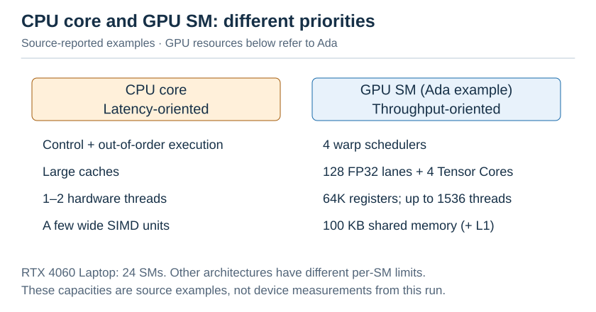

图：CPU core 与 GPU SM（沿用原文示例或报告值，未重新测量）。

### 1.2 线程层次：grid → block → warp → thread

写 CUDA 时你会定义一个 **kernel**（`__global__` 函数），然后用 `kernel<<<grid, block>>>(...)` 启动它：

- **grid**：本次启动的全部线程，由若干个 block 组成；
- **block**（线程块）：最多 1024 个线程，**保证在同一个 SM 上运行**。同一个 block 内的线程可以共享 shared memory，并用 `__syncthreads()` 同步；
- **warp**：硬件把 block 内的线程每 32 个分成一组，这一组就是 warp。**一个 warp 中的 32 个线程同时执行同一条指令**，这就是 SIMT（single instruction, multiple threads）；
- **thread**：每个线程用 `blockIdx`、`threadIdx` 算出自己负责哪个数据。

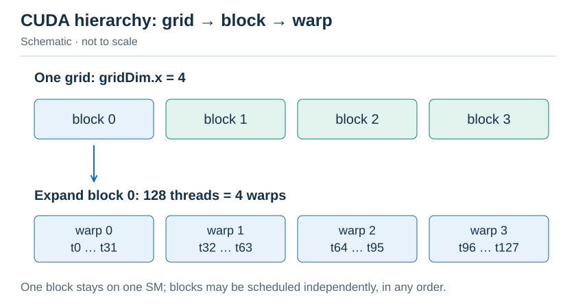

图：Grid/block/warp/thread 层次（示意，不按耗时或容量比例）。

**全局下标**：`i = blockIdx.x * blockDim.x + threadIdx.x`。lab A1 的 grid-stride 循环是 `for (i = ...; i < n; i += blockDim.x * gridDim.x)`：线程总数少于元素数时，每个线程处理多个元素。

> [!warning] 分支发散（divergence）
> warp 中的 32 个线程如果走了 `if` 的不同分支，硬件会**先执行一边、再执行另一边**，两段时间相加。所以在 GPU 上写分支时，要尽量让同一个 warp 内的线程走同一条路径。

### 1.3 Occupancy 与延迟隐藏

一次 global memory 访问需要约 400–800 个时钟周期。GPU 靠**同时驻留很多 warp**来隐藏这段延迟：warp A 等内存时，调度器在下一个周期发射 warp B 的指令。

一个 SM 能同时驻留多少 warp，受三种资源限制（以 Ada 架构为例）：

| 资源          | 每个 SM 的总量          | 例子：每个线程用 64 个寄存器、block 为 256 线程、每个 block 用 $16\,\mathrm{KB}$ smem |
| ------------- | ----------------------- | ------------------------------------------------------------------------------------- |
| 线程数        | 1536（48 个 warp）      | $1536/256=6$ 个 block（最多）                                                         |
| 寄存器        | 65536 个                | $65536/(64\times 256)=4$ 个 block（最多）                                             |
| shared memory | 最多 $100\,\mathrm{KB}$ | $100/16$，最多 6 个 block                                                             |

取三者最小值：每个 SM 驻留 4 个 block，即 32 个 warp，$\mathrm{occupancy}=32/48=67\%$。

occupancy 不是越高越好。lab B4 每个线程用 100 多个寄存器，occupancy 不高，但每个线程做的计算很多，靠**指令级并行**同样能隐藏延迟。这个权衡要通过测量来判断。

### 1.4 算出你 GPU 的“天花板”

$$
\text{FP32 峰值} = \text{SM 数} \times \text{每 SM 的 FP32 单元数} \times 2\,(\text{FMA}) \times \text{频率}
$$

| GPU             | SM  | FP32 单元/SM | 频率（boost）                                        | FP32 峰值                      | FP16 Tensor（FP32 累加）       | 显存带宽                                    |
| --------------- | --- | ------------ | ---------------------------------------------------- | ------------------------------ | ------------------------------ | ------------------------------------------- |
| RTX 4060 Laptop | 24  | 128          | $2.2\text{--}2.6\,\mathrm{GHz}$（80 W 功耗墙下实测） | $\approx 15\,\mathrm{TFLOP/s}$ | $\approx 30\,\mathrm{TFLOP/s}$ | $256\,\mathrm{GB/s}$（cudaMemcpy 实测 213） |
| RTX 4090        | 128 | 128          | $2.52\,\mathrm{GHz}$                                 | 82.6                           | 165                            | $1008\,\mathrm{GB/s}$                       |
| A100 SXM        | 108 | 64           | $1.41\,\mathrm{GHz}$                                 | 19.5                           | 312                            | $2039\,\mathrm{GB/s}$                       |
| H100 SXM        | 132 | 128          | $1.83\,\mathrm{GHz}$                                 | 67                             | 989                            | $3350\,\mathrm{GB/s}$                       |

注意两件反直觉的事：

1. **GeForce 卡的 Tensor Core 被“限速”了**：FP32 累加时，Ada GeForce 的 FP16 Tensor 吞吐只有 FP32 的 2 倍；数据中心卡（A100、H100）是 16 倍左右。所以在你的 4060 上，Part C 的加速比会比论文里报告的数字小得多。
   作者实测：cuBLAS SGEMM 约 $7.8\,\mathrm{TFLOP/s}$（峰值的约 $52\%$），cuBLAS HGEMM 约 $29.5\,\mathrm{TFLOP/s}$（接近峰值）。注意 FP32 GEMM 本身也达不到峰值，原因之一是功耗墙：FP32 单元全开时更耗电，频率被压得更低。
2. **Roofline 拐点很高**：4060 Laptop 的 FP32 拐点约为 $\frac{15\times 10^{12}}{256\times 10^9}\approx 60\,\mathrm{FLOP/Byte}$，比 CPU 的约 8 高得多。GPU 上更多的算子是访存受限的。

lab 报告要求你用 `cudaGetDeviceProperties`（测试 `A0_device_is_visible` 会打印出来）和 `nvidia-smi -q -d CLOCK` 查到自己 GPU 的真实参数，再算出这两个峰值。

> [!question]- 自测 1.1：block 大小为 100 时，一个 block 有几个 warp？浪费了多少？
> $\lceil 100/32\rceil=4$ 个 warp。最后一个 warp 只有 4 个有效线程，另外 28 个 lane 空转，浪费 $28/128\approx 22\%$。所以 block 大小应该取 32 的倍数。

> [!question]- 自测 1.2：为什么 lab A1 的启动参数是约 $8\times\mathrm{SM}$ 个 block，而不是 $n/256$ 个？
> $n=6400\times 10^4$ 时，$n/256=25\times 10^4$ 个 block。block 的启动和调度本身有开销；而且同时驻留的 block 数受 occupancy 限制，多出来的 block 只能排队。grid-stride 循环让固定数量的线程处理任意规模的数据：block 数只需足够填满所有 SM，并留一些余量用于负载均衡即可。

---

## §2 内存：合并、shared memory 与 bank

### 2.1 内存层次

| 层级           | 作用域       | 容量（Ada SM）                                                  | 延迟               | 谁来管理         |
| -------------- | ------------ | --------------------------------------------------------------- | ------------------ | ---------------- |
| 寄存器         | 线程私有     | $64\mathrm{K}\times 4\,\mathrm{B}=256\,\mathrm{KB}/\mathrm{SM}$ | $\approx 1$ 周期   | 编译器           |
| shared memory  | block 内共享 | 最多 $100\,\mathrm{KB}$ / SM（与 L1 共用 $128\,\mathrm{KB}$）   | $\approx 30$ 周期  | **你**           |
| L1 cache       | SM 私有      | 剩余部分                                                        | $\approx 30$ 周期  | 硬件             |
| L2 cache       | 全 GPU       | $32\,\mathrm{MB}$（4060）                                       | $\approx 200$ 周期 | 硬件             |
| global（显存） | 全 GPU       | $8\,\mathrm{GB}$                                                | $\approx 500$ 周期 | 你（cudaMalloc） |

与 CPU 最大的不同在于 **shared memory**：它是一块由程序员显式读写的片上缓存。lab0 里你“希望”数据留在 L1 或 L2 里；在 GPU 上，你直接把它放进 shared memory。

### 2.2 合并访存（coalescing）

一个 warp 执行一条 load 指令时，32 个线程各给出一个地址。硬件把这些地址合并成若干个 **32 字节的 sector** 去读。

在 4 字节元素、32 字节 sector 且起始地址对齐的模型中：

| lane i 的地址 | sector 数 | 传输量 | 有效数据量 |
| --- | --- | --- | --- |
| `a[i]` | 4 | 128 B | 128 B |
| `a[i * 1024]` | 32 | 1024 B | 128 B |

后一种访问的流量放大为 8 倍；这不是耗时倍数的测量结果。

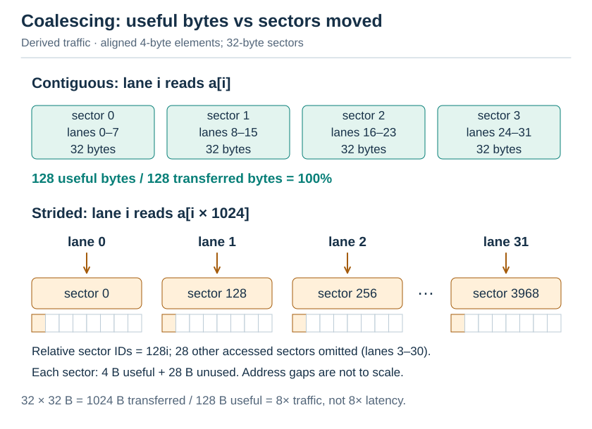

图：连续访问覆盖四个相邻 sector；跨步访问中，lane 0、1、2、31 分别落入相对 sector 0、128、256、3968，中间 28 个被访问 sector 省略。地址间隔不按比例；每个小格代表 4 B，跨步访问每个 sector 仅一个格子有效。

**lab B0 → B1** 演示的正是这一点。naive kernel 让 `threadIdx.x` 对应 $C$ 的**行**，一个 warp 的 32 个线程分别读 $A$ 的 32 行（相距 $K$ 个 float），写 $C$ 的 32 行（相距 $N$ 个 float），完全无法合并。只要交换 `x`、`y` 的角色，同一个 warp 就读 $B$ 的同一行中连续 32 个 float（合并），并且读 $A$ 的同一个元素（广播，一次读取供给全部 32 个线程）。

### 2.3 shared memory 的 bank

本节采用 **32 个 bank、每个 bank 宽 4 字节**的模型；地址 `addr` 落在 bank $\lfloor\mathrm{addr}/4\rfloor\bmod 32$。分析冲突要以**单个 shared memory 事务**为单位：若同一事务中有 $k$ 个不同字地址落入同一 bank，就需要串行服务，称为 $k$-way bank conflict；读取同一字地址可以广播。下面先讨论每个 lane 读取一个 FP32 的情形，64 位访问的事务划分见自测 2.2。

以 lab A3 的转置为例。tile 是 `float tile[32][32]`，写回阶段每个线程读 `tile[tx][j]`，也就是 32 个线程读**同一列**：

无 padding 时，元素 $(r,c)$ 的字下标和 bank 分别为：

$$
\mathrm{word}=32r+c,\qquad \mathrm{bank}=(32r+c)\bmod 32=c.
$$

加一列 padding 后，`tile[32][33]` 中对应的映射为：

$$
\mathrm{word}=33r+c,\qquad \mathrm{bank}=(r+c)\bmod 32.
$$

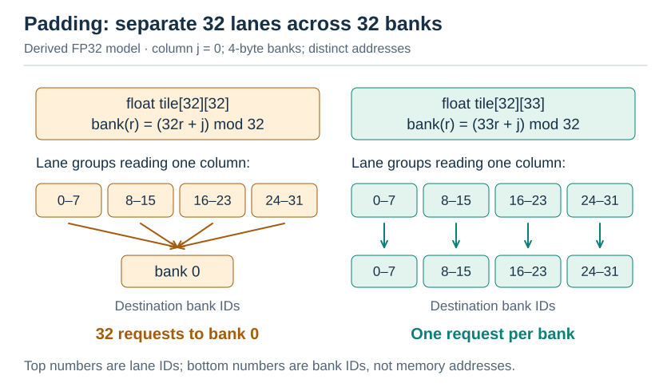

图：FP32 按列读取的 bank 分布，示例固定 j=0；其他列只会循环平移 bank 编号。32-way 与无冲突指本节的 4 字节 bank 模型，double 的事务分析见折叠自测。

在上述 FP32 bank 模型中，多加一列 padding 就消除了这次按列读取的 32-way bank conflict。lab A3b 只要求改这一处，然后测出差别。

### 2.4 warp shuffle：在寄存器之间交换数据

`__shfl_down_sync(mask, v, d)` 在来源 lane 有效且参与调用时，让 lane $i$ 读到 lane $i+d$ 的寄存器值，不经过 shared memory。下面按 offset 16、8、4、2、1 跟踪来源集合：

以下示例明确假设整个 warp 的 32 个 lane 都参与，`width=32`。所有 lane 都调用 shuffle，只在来源未越界时累加：

```cpp
unsigned lane = threadIdx.x & 31;
for (int d = 16; d > 0; d >>= 1) {
    float other = __shfl_down_sync(0xffffffffu, v, d);
    if (lane + d < 32) v += other;
}
// lane 0 now holds the reduction result.
```

`lane+d>=32` 时 shuffle 返回本 lane 的值，不能把它算作新的来源；若目标 lane 未参与，读取结果无定义。图只跟踪 lane 0，每一轮都读取轮初状态。

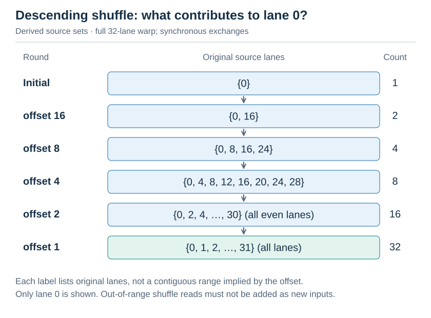

图：递减 offset 的 shuffle 归约，展示 lane 0 的完整来源集合。每轮读取轮初状态；最后才覆盖全部 32 个 lane。

lab A2 的三级结构，是所有 GPU 归约（包括 softmax、LayerNorm）共同的骨架：每个线程先在寄存器里累加，再在 warp 内用 shuffle 归约，然后在 block 内借助 shared memory 汇总，最后在 grid 层面再启动一次 kernel。

> [!question]- 自测 2.1：一个 warp 读 `float a[2 * lane]`（步长为 2）。读了多少个 sector？有效数据占多少？
> 地址跨度为 64 个 float，即 $256\,\mathrm{B}$，共 8 个 sector；有效数据为 $128\,\mathrm{B}$，**利用率为 $50\%$**。

> [!question]- 自测 2.2：`double tile[32][32]`（8 字节元素）按列读时，冲突几路？加一列 padding 还管用吗？
> 不能只数整个 warp 中重复的起始 bank；需要先知道指令如何划分事务。下面作一个明确的条件式分析：32 个 lane 各读一个 8 B 的 double，总共 256 B，按 lane 0–15 与 16–31 分成两个 128 B 事务，每个 bank 按 4 B 字服务。
>
> 无 padding 时，元素 $(r,c)$ 的起始字为 $2(32r+c)$，起始 bank 为 $(64r+2c)\bmod32$。每个事务内 16 个不同 double 都访问同一对 bank，因此在这个模型中是 16-way 冲突。
>
> padding 成 `[32][33]` 后，起始 bank 为 $(66r+2c)\bmod32=(2r+2c)\bmod32$，每个 double 还占下一个 bank。**在各自的 16-lane 事务内，32 个 bank 恰好各被访问一次，没有额外 bank conflict。**两个事务来自 256 B 的请求量，不能把它们等同于 2-way 冲突。实际结论取决于编译出的指令、架构与事务拆分方式；本题未作硬件测量。

---

## §3 SGEMM 阶梯：每次 FMA 要读几次内存

### 3.1 一个统一的分析量

用 **每次 FMA 需要的内存读取次数** 来衡量每一步优化，数值越小越好：

| 步骤                       | 每个线程算       | 每个 $k$ 步的读取       | FMA | 读取 / FMA | 读取来源                     |
| -------------------------- | ---------------- | ----------------------- | --- | ---------- | ---------------------------- |
| B0/B1 naive                | 1 个 $C$         | $A$ 1 次 $+$ $B$ 1 次   | 1   | 2          | global（B1 能合并，B0 不能） |
| B2 smem $32\times 32$      | 1 个 $C$         | `As` 1 次 $+$ `Bs` 1 次 | 1   | 2          | **shared**                   |
| B3 1D 分块 $\mathrm{TM}=8$ | 8 个 $C$（一列） | `As` 8 次 $+$ `Bs` 1 次 | 8   | 1.125      | shared                       |
| B4 2D 分块 $8\times 8$     | 64 个 $C$        | `As` 8 次 $+$ `Bs` 8 次 | 64  | 0.25       | shared                       |

从 B2 起，读取来源变成了 shared memory；从 B3 起，被复用的值留在寄存器里。这和 lab0 的 CPU 路线一一对应：

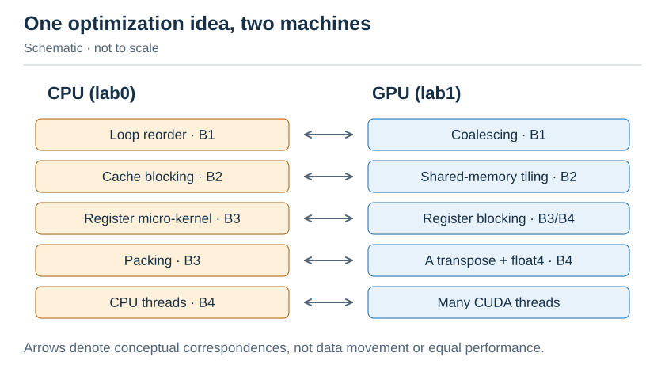

图：CPU/GPU 优化阶梯对应（示意，不按耗时或容量比例）。

### 3.2 B2：shared memory 分块

一个 $32\times 32$ 的 block 负责 $C$ 的一个 $32\times 32$ tile。沿 $K$ 方向，每次把 $A$ 的 $32\times 32$ 块和 $B$ 的 $32\times 32$ 块搬进 shared memory，算完再搬下一块：

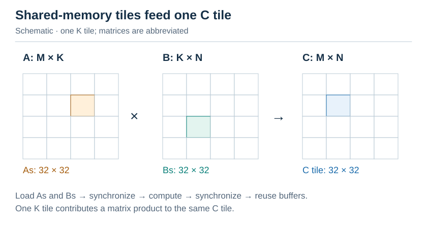

图：Shared memory GEMM 分块（示意，不按耗时或容量比例）。

每个元素从 global memory 读进来一次，之后被 block 内的 32 个线程复用，global 访问量因此减少到原来的 $1/32$。两次 `__syncthreads()` 缺一不可：第一次保证 tile 已经全部写入，第二次保证所有线程都用完了旧 tile，下一轮才能覆盖它。

> [!note] 为什么 B2 只比 B1 快了一点？
> 在作者的 4060 Laptop 上，B1 是 $0.98\,\mathrm{TFLOP/s}$，B2 是 $1.23$，只快了 $25\%$，远没有 “global 访问减少 32 倍” 听上去那么多。原因有两个：
>
> 1. **B1 其实已经有复用了**：同一个 block 中的线程读的是 $A$ 的相同行和 $B$ 的相同列，这些数据大多会命中 L1 或 L2 缓存，B1 真正落到 DRAM 的访问远少于理论值。
> 2. **瓶颈转移了**：B2 中每次 FMA 仍要读两次 shared memory（见 §3.1 的表），而一个 SM 每周期能提供的 shared memory 带宽有限，小于 FP32 单元的需求。所以 B2 是 **shared memory 带宽受限**，要靠寄存器分块（B3、B4）来解决。
>
> 这正是 lab 要你“用测量解释每一步”的原因：直觉上的大优化，可能只是把瓶颈从一处挪到另一处。

### 3.3 B3、B4：寄存器分块

B2 中每次 FMA 仍要读两次 shared memory，而 shared memory 的带宽也有限。办法和 lab0 的微内核一样：**让一个线程计算多个输出，把重复使用的值留在寄存器里。**

每个 d 步，线程读取 `reg_m[0:8]`（As 的第 d 列）和 `reg_n[0:8]`（Bs 的第 d 行），再执行：

```text
for i in 0..7:
    for j in 0..7:
        acc[i][j] += reg_m[i] * reg_n[j]
```

合计 16 次 shared memory 标量读取、64 次标量 FMA。

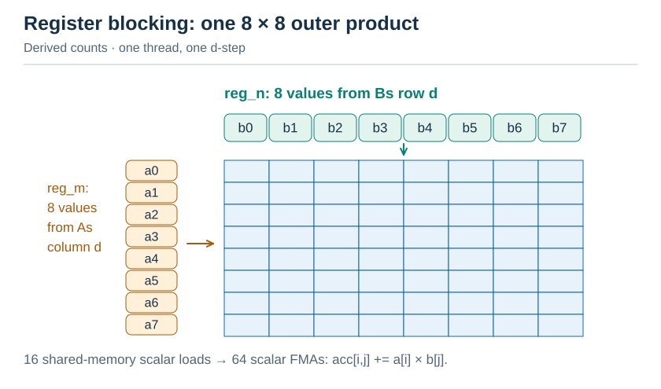

图：线程内 8×8 外积（按本节参数推导，非实测）。

B4 另有两个细节：

- **$A$ 转置后存入 shared memory**（`As[k][m]`）：计算循环中，一个线程读 `As[d][thread_row*8 + 0..7]`，8 个数在内存里是连续的；
- **float4 向量化访存**：一条指令读 16 字节，指令数减少到原来的 $1/4$。

siboehm 在 A6000 上测得，到这一步（他的 kernel 6）能达到 cuBLAS 的约 $78\%$。剩下的差距来自 warp tiling、双缓冲和 bank conflict 优化，这些内容列为选修（他的 kernel 7–10）。

> [!question]- 自测 3.1：B4 中每个线程 `acc` 有 64 个 float，加上 `reg_m`、`reg_n` 共 80 个寄存器以上。block 为 256 线程时，一个 SM 最多驻留几个 block？
> 假设每个线程用 128 个寄存器（编译器还要用一些）：$65536/(128\times 256)=2$ 个 block，即 16 个 warp，occupancy 为 $33\%$。这已经够用了：每个线程有 64 条相互独立的 FMA，靠指令级并行就能隐藏延迟。打开 `-DL1_PTXAS_VERBOSE=ON` 可以看到实际的寄存器数。

---

## §4 Tensor Core

### 4.1 一条指令，一块矩阵乘

FP32 单元一次做一个 `a*b+c`。Tensor Core 一条 `mma` 指令由整个 warp 协作完成一块矩阵乘，例如 `m16n8k16`：$D_{16\times 8}\leftarrow D_{16\times 8}+A_{16\times 16}\times B_{16\times 8}$，共 $16\times 8\times 16=2048$ 次 FMA。

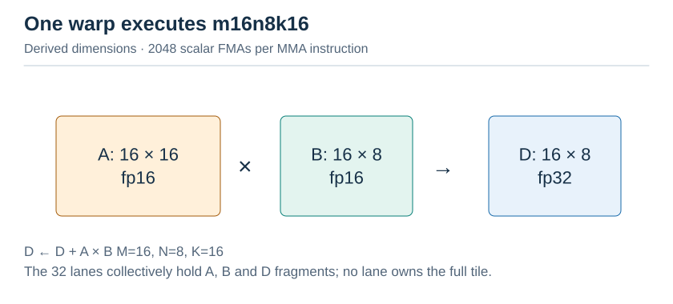

图：m16n8k16 矩阵形状（按本节参数推导，非实测）。

数据由 32 个线程分别持有，每个线程只持有 $A$、$B$、$D$ 的一小片，称为 **fragment**。每个线程持有哪些元素，由硬件布局规定。

### 4.2 WMMA（lab C1）：先把布局藏起来

`nvcuda::wmma` 是 CUDA 提供的 C++ 封装，`load_matrix_sync`、`mma_sync`、`store_matrix_sync` 三个函数替你处理布局。C1 直接从 global memory 加载 fragment，没有用 shared memory。即便如此，它在你的 GPU 上也已经快过所有 FP32 kernel，因为算力上限翻了一倍。

WMMA 的局限是：fragment 布局对你不透明，无法控制数据怎样从 shared memory 搬进寄存器，也就无法消除 bank conflict、无法做细粒度的流水线。所以高性能库都直接写 PTX 的 `mma.sync`。

### 4.3 `mma.sync` 与 `ldmatrix`：从布局推导地址（lab C2b）

`m16n8k16` 的 $A$ fragment 布局（PTX ISA 规定，记 $g=\lfloor\mathrm{lane}/4\rfloor$，$t=\mathrm{lane}\bmod 4$）：

各寄存器的精确坐标如下；`g=lane//4`，`t=lane%4`，每个寄存器装两个 half：

| 寄存器 / 子块 | 行 | 两个列下标 |
| --- | --- | --- |
| `a[0]` / 0 | `g` | `2t, 2t+1` |
| `a[1]` / 1 | `g+8` | `2t, 2t+1` |
| `a[2]` / 2 | `g` | `2t+8, 2t+9` |
| `a[3]` / 3 | `g+8` | `2t+8, 2t+9` |

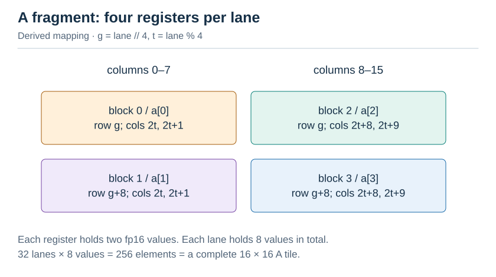

图：A fragment 的 lane 映射（按本节参数推导，非实测）。

`ldmatrix.x4` 一次加载 4 个 $8\times 8$ 矩阵，lane $i$ 提供第 $i$ 行的地址：lane 0–7 给矩阵 0 的 8 行，lane 8–15 给矩阵 1 的 8 行，以此类推。加载完成后，lane $i$ 在 $r[m]$ 里拿到矩阵 $m$ 中第 $\lfloor i/4\rfloor$ 行、第 $2(i\bmod 4)$ 和 $2(i\bmod 4)+1$ 列的元素，**恰好就是 mma 要求的 fragment 布局**。

于是地址公式只需要让“矩阵 $m$”对上“块 $m$”：

提供行起始地址的 lane 使用以下整数索引：

```text
row = lane % 16
col = (lane // 16) * 8
matrix = lane // 8
```

lane 0–7、8–15、16–23、24–31 分别提供 matrix 0、1、2、3 的八个行地址；这与最终 fragment 的寄存器持有者映射是不同角色。

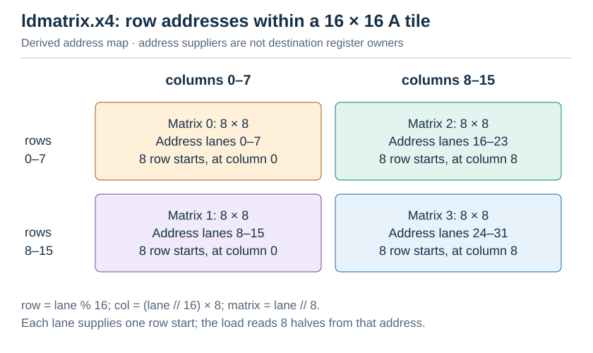

图：16×16 的 A tile 按实际行列拆成四个 8×8 子矩阵。框内 lane 只负责提供行起始地址；最终 fragment 中各寄存器的持有者见前一图。

因此，C2b 的地址公式为：

$$
\mathrm{row}=\mathrm{lane}\bmod 16,\qquad
\mathrm{col}=\left\lfloor\frac{\mathrm{lane}}{16}\right\rfloor\times 8.
$$

$B$ 在 shared memory 中按 `Bs[k][n]` 存放，而 mma 要求 $B$ fragment 中相邻的两个元素沿 $k$ 方向排列。所以 $B$ 使用 `ldmatrix.trans`，在加载时把每个 $8\times 8$ 块转置。一次 `.x4.trans` 覆盖 $\underbrace{16}_{k}\times\underbrace{16}_{n}$，正好是两个 $n=8$ 的 fragment。推导过程与 $A$ 完全相同，留作练习，答案在 `ptx.cuh` 的注释和 lab TODO C2b 中。

### 4.4 padding：消除 ldmatrix 的 bank conflict

`ldmatrix` 每个阶段由 8 个 lane 各读 16 字节，即一个 $8\times 8$ 矩阵的 8 行。$A$ tile 每行有 $\mathrm{BK}=32$ 个 half，即 64 字节；第 $r$ 行的起始 bank 为 $(64r/4)\bmod 32=16r\bmod 32$：

每个加载阶段为 8 个 lane 各读取 16 B（四个相邻 bank）：

| 行距 | rows 0..7 的起始 bank | 阶段内冲突 |
| --- | --- | --- |
| 64 B（32 halves） | `0,16,0,16,0,16,0,16` | 4-way |
| 80 B（40 halves） | `0,20,8,28,16,4,24,12` | 无 |

80 B 行距的起始 bank 为 `20*r % 32`，每行再覆盖该 bank 后的三个 bank。

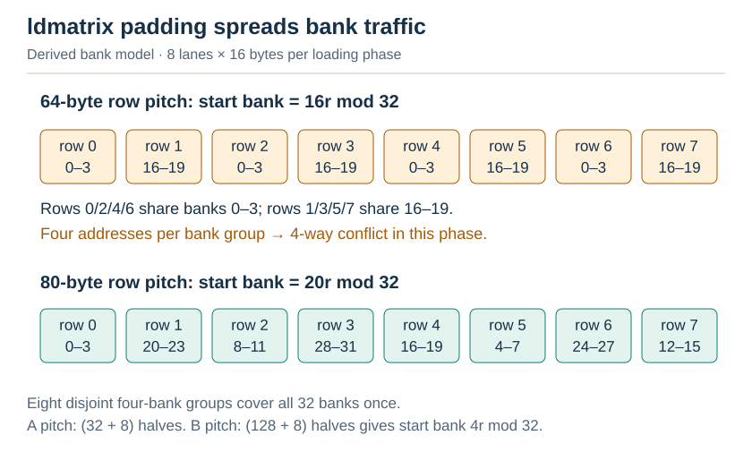

图：ldmatrix 的 bank 分布（按本节参数推导，非实测）。

所以 lab 中 `As` 的行宽取 $\mathrm{BK}+8=40$，`Bs` 取 $\mathrm{BN}+8=136$（行宽 $272\,\mathrm{B}$，起始 $\mathrm{bank}=4r\bmod 32$，同样无冲突）。代价是多占 $25\%$ 的 shared memory。CUTLASS 改用 **XOR swizzle** 打乱列地址，不占额外空间（lab 可选挑战 C3）。

### 4.5 cp.async 与多级流水线（lab C2a、C2c）

普通的 global → shared 拷贝要经过寄存器：先 load 到寄存器，再 store 进 shared memory；load 返回之前，线程什么都做不了。Ampere 引入的 `cp.async` 让拷贝**异步**进行：发出指令后，线程可以立刻去算别的东西。

于是可以搭建一条**软件流水线**：shared memory 中开 $S$ 个缓冲区（stage），计算第 $k$ 块的同时，第 $k+1,\ldots,k+S-1$ 块正在路上。

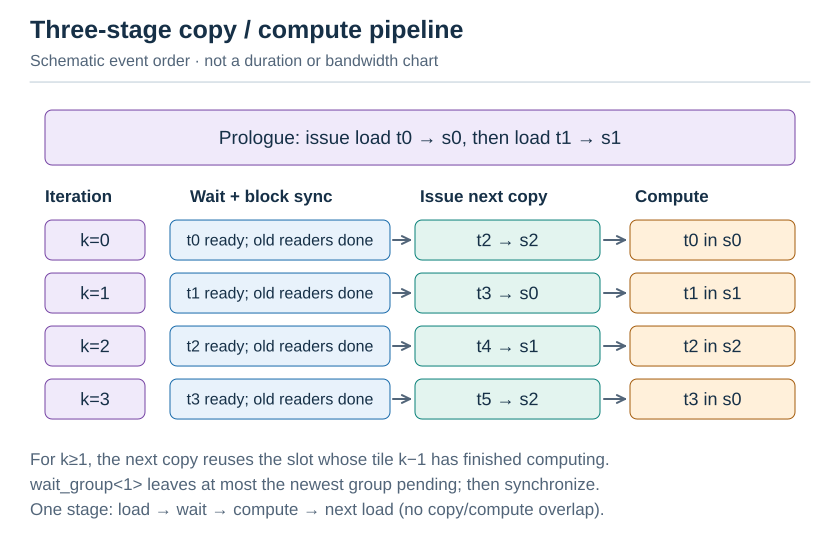

图：三缓冲的事件顺序示意，非实测时间线。预填充、等待、同步、发起下一次拷贝与计算分开表示；尾部仍按原文提交空组。

lab C2c 中，`cp_async_wait<S-2>()` 的含义是“除最近发出的 $S-2$ 组之外，其余都已完成”，也就是第 $\mathrm{kt}$ 块已经到达。紧接着的 `__syncthreads()` 同时保证两件事：所有线程都能看到第 $\mathrm{kt}$ 块；所有线程都算完了第 $\mathrm{kt}-1$ 块，它占用的缓冲区可以覆盖了。

> [!important] 这个结构无处不在
> “异步拷贝 + 多级缓冲 + Tensor Core 计算”是 CUTLASS 的 Ampere GEMM、FlashAttention-2 的内循环、vLLM 各种 kernel 共同的骨架。L2 的 FlashAttention 会直接复用它。

> [!question]- 自测 4.1：C2 一个 block 每个 K-tile 要搬运多少字节、做多少 FLOP？算术强度是多少？
> 搬运 $A$ 的 $128\times 32$ 个 half 和 $B$ 的 $32\times 128$ 个 half，共 $8192\times 2\,\mathrm{B}=16\,\mathrm{KB}$；计算量为 $2\times 128\times 128\times 32=1.05\,\mathrm{MFLOP}$。算术强度为 $\frac{1.05\mathrm{M}}{16\mathrm{K}}\approx 64\,\mathrm{FLOP/Byte}$（相对 global memory）。4060 Laptop 的 FP16 Tensor 拐点约为 $\frac{30\times 10^{12}}{256\times 10^9}\approx 115$。所以 $128\times 128$ 的 tile 在你的卡上仍然稍偏访存受限，好在 L2 缓存（$32\,\mathrm{MB}$）会吸收大量重复读取。更大的 tile 能提高强度，但会占用更多寄存器和 shared memory。

> [!question]- 自测 4.2：为什么 C2c 中，即使没有发出 load 也要 `cp_async_commit()`？
> `wait_group N` 按**组的个数**计数。如果最后几轮不提交空组，在流水线的尾部，“最近 $S-2$ 组”就会包含本该已经完成的那一块，wait 不会再等待它，可能读到未到达的数据。每轮恰好提交一组，计数才能和 tile 编号一一对应。

---

## §5 从基础到前沿：演进脉络

### 5.1 GEMM kernel 的演进

| 年份  | 工作                                                                                                                                                                                                | 解决了上一步的什么问题                                                                                                                                                                   |
| ----- | --------------------------------------------------------------------------------------------------------------------------------------------------------------------------------------------------- | ---------------------------------------------------------------------------------------------------------------------------------------------------------------------------------------- |
| 2008– | CUDA 与 cuBLAS                                                                                                                                                                                      | 用 shared memory 分块，让 GPU 跑通用矩阵乘                                                                                                                                               |
| 2017  | Volta Tensor Core + WMMA                                                                                                                                                                            | 专用矩阵单元，吞吐提升一个数量级                                                                                                                                                         |
| 2017– | [CUTLASS](https://github.com/NVIDIA/cutlass) 1.x/2.x                                                                                                                                                | 把分层 tiling（block → warp → mma）写成 C++ 模板，人人都能组合出接近 cuBLAS 的 kernel                                                                                                    |
| 2020  | Ampere：`cp.async` + `ldmatrix` + `mma.sync`                                                                                                                                                        | 异步拷贝和多级流水线，隐藏访存延迟，**本讲 §4 的内容**                                                                                                                                   |
| 2022  | Hopper：**TMA** + **WGMMA** + warp specialization（[Colfax: WGMMA](https://research.colfax-intl.com/cutlass-tutorial-wgmma-hopper/)、[TMA](https://research.colfax-intl.com/tutorial-hopper-tma/)） | TMA 用一条指令搬运整块 tile，不再需要每个线程算地址；WGMMA 让 4 个 warp 共同完成一个更大的 mma；“生产者 warp 只搬数据，消费者 warp 只做计算”的分工方式，把流水线从软件实现变成了硬件支持 |
| 2023  | CUTLASS 3 / [CuTe](https://github.com/NVIDIA/cutlass/tree/main/media/docs)                                                                                                                          | 用“布局代数”统一描述 tensor 与线程的映射；swizzle 等技巧都能用它表达                                                                                                                     |
| 2024  | [ThunderKittens](https://arxiv.org/abs/2410.20399)（ICLR'25）                                                                                                                                       | 以 $16\times 16$ tile 为基本单位的小型 DSL，用几百行代码写出与 FlashAttention-3 竞争的 kernel                                                                                            |
| 2025  | [DeepGEMM](https://github.com/deepseek-ai/DeepGEMM)                                                                                                                                                 | FP8 GEMM，核心约 300 行，JIT 编译；DeepSeek-V3 训练与推理的实际依赖                                                                                                                      |
| 2025  | Blackwell：`tcgen05` + **TMEM**（[Colfax 教程](https://research.colfax-intl.com/cutlass-tutorial-writing-gemm-kernels-using-tensor-memory-for-nvidia-blackwell-gpus/)）                             | 累加器从寄存器移到专用的 Tensor Memory，寄存器压力不再限制 tile 大小                                                                                                                     |

**数据搬运逐步交给专用硬件**（TMA、TMEM），**编程抽象逐步上移**（tile 级的 DSL：Triton、TileLang、CuTe-DSL、ThunderKittens）。L2 和 L3 会沿着这两条线继续往下讲。

### 5.2 本讲的研究问题种子

- **自动选 tile**：对给定的 $(M,N,K)$ 和 GPU，怎样快速选出 $\mathrm{BM}$、$\mathrm{BN}$、$\mathrm{BK}$、$\mathrm{STAGES}$？cuBLAS 用启发式规则，Triton 靠 autotune 实测。能否用一个简单的分析模型（访存量、occupancy、wave quantization）预测出前三名？
- **小 batch / 瘦长矩阵**：推理 decode 阶段的 GEMM 形如 $M=1\text{--}16$、$N$ 和 $K$ 达数千。这时瓶颈在访存而不在计算，最优 kernel 的结构完全不同（split-K、stream-K）。lab 的 C2 在这类形状上表现如何？
- **GeForce 上的 Tensor Core**：FP32 累加被限速时，FP16 累加或混合累加能否在保证精度的前提下换取 2 倍吞吐？

---

## 可视化资料汇总

| 资料                                                                                                                                            | 形式                                        | 配合哪一节   |
| ----------------------------------------------------------------------------------------------------------------------------------------------- | ------------------------------------------- | ------------ |
| [Modal GPU Glossary](https://modal.com/gpu-glossary)                                                                                            | 图文 + 交互，GPU 术语百科                   | 全讲随时查   |
| [JAX Scaling Book: GPUs](https://jax-ml.github.io/scaling-book/gpus/)                                                                           | SM、内存层次、Roofline 的图解               | §1、§2       |
| [CUDA Programming Guide: Hardware Implementation](https://docs.nvidia.com/cuda/cuda-c-programming-guide/index.html)                             | 官方文档，SIMT 与线程层次                   | §1           |
| [NVIDIA: Efficient Matrix Transpose](https://developer.nvidia.com/blog/efficient-matrix-transpose-cuda-cc/)                                     | 博客，transpose 与 bank conflict 的经典图解 | §2.3、lab A3 |
| [GPU Puzzles](https://github.com/srush/GPU-Puzzles)（Sasha Rush）                                                                               | Notebook 谜题，可视化线程与内存访问         | §1–§2 热身   |
| [siboehm: How to Optimize a CUDA Matmul Kernel](https://siboehm.com/articles/22/CUDA-MMM)                                                       | 博客，SGEMM 阶梯每一步都有图                | **§3 主线**  |
| [Aleksa Gordić: Inside NVIDIA GPUs](https://www.aleksagordic.com/blog/matmul)                                                                   | 长文，从硬件结构讲到 Hopper matmul          | §3、§4、§5   |
| [Lei Mao: CUDA Matrix Multiplication Optimization](https://leimao.github.io/article/CUDA-Matrix-Multiplication-Optimization/)                   | 博客，含 Tensor Core 版本                   | §3、§4       |
| [Colfax: WGMMA](https://research.colfax-intl.com/cutlass-tutorial-wgmma-hopper/) / [TMA](https://research.colfax-intl.com/tutorial-hopper-tma/) | 教程，Hopper 的数据流图                     | §5           |
| [GPU MODE 讲座](https://github.com/gpu-mode/lectures)（[视频](https://www.youtube.com/@GPUMODE)）                                               | 讲座，profiling、CUTLASS、Tensor Core 专题  | 延伸         |

## 自测清单

- [ ] 能解释 grid / block / warp / thread 的关系，以及为什么 `__syncthreads()` 只在 block 内有效
- [ ] 能算出给定寄存器和 smem 用量下的 occupancy
- [ ] 能为自己的 GPU 算出 FP32 与 FP16 Tensor 峰值，以及 Roofline 拐点
- [ ] 能判断一个访存模式会读多少个 sector，以及是否发生 bank conflict、冲突几路
- [ ] 能说出 SGEMM 阶梯每一步的“读取 / FMA”比值
- [ ] 能从 mma 的 fragment 布局推导出 ldmatrix 的地址公式
- [ ] 能画出 3 级 cp.async 流水线的时间线，并说明每个 wait 和 sync 的作用
- [ ] 能说出 Hopper 的 TMA、WGMMA 分别替代了 Ampere kernel 中的哪一部分
