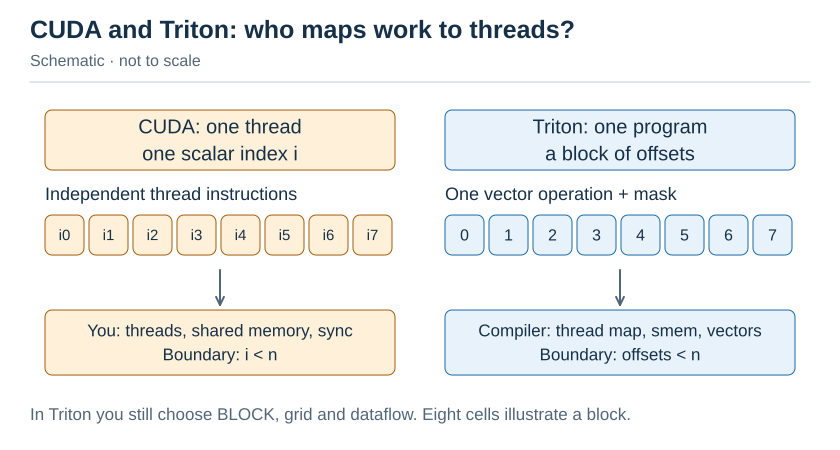
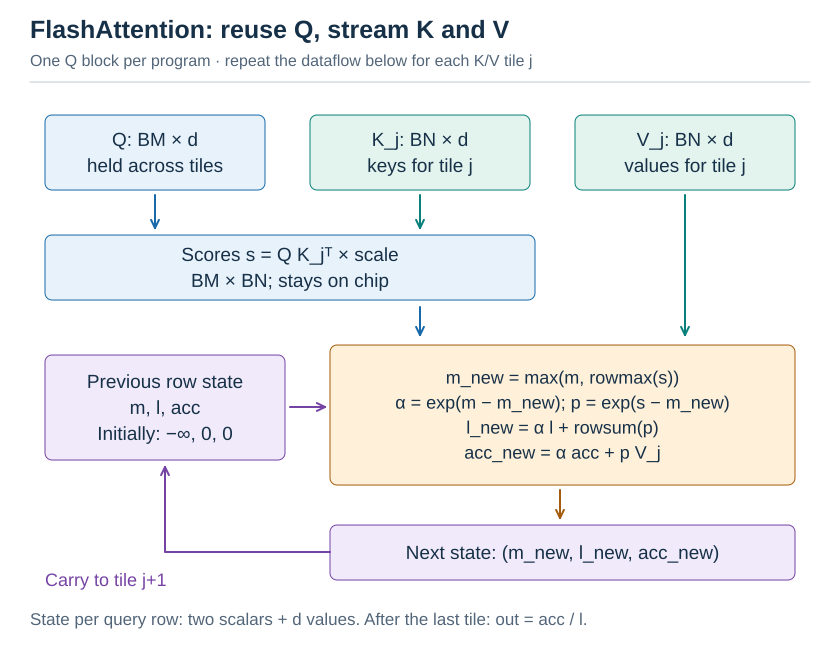
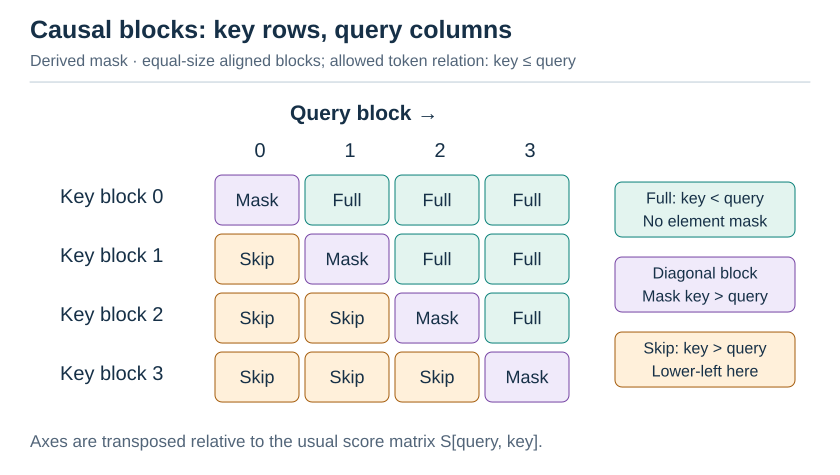
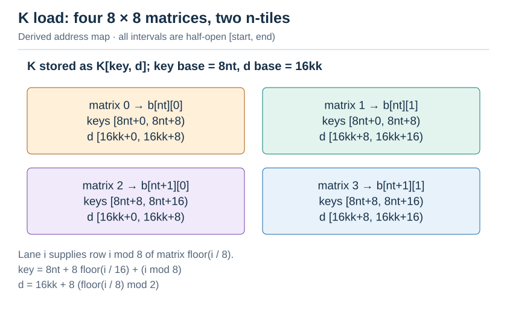
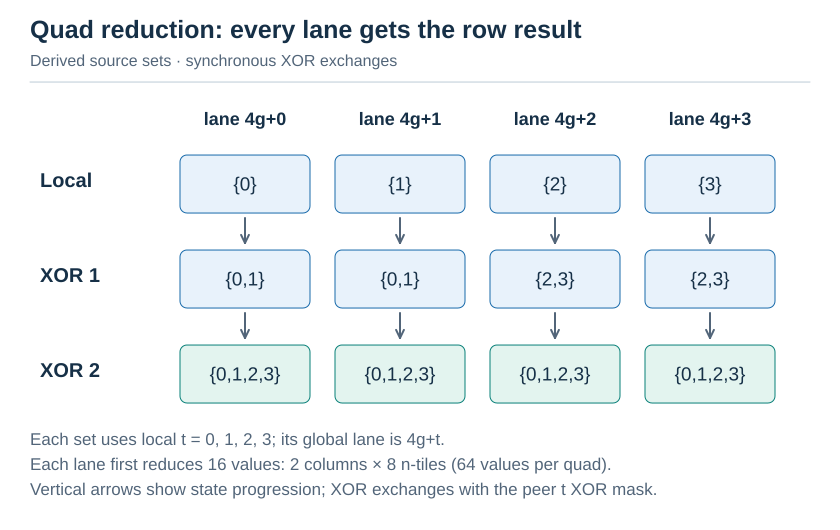
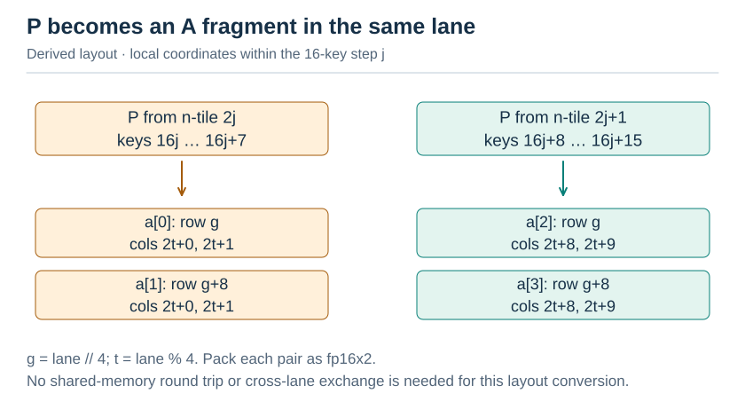
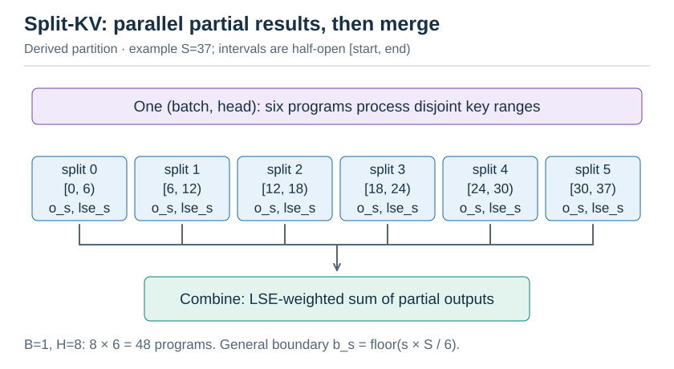

# L2 Attention：从 online softmax 到 FlashAttention

[← 课程大纲](../syllabus.md) · 上一讲：[L1 CUDA GEMM](L1-cuda-gemm.md) · 配套实验：[lab2](../../labs/lab2/README.md) · 下一讲：[L3 编译器与超优化](L3-compilers.md)

> [!abstract] 这一讲要解决的三个问题
>
> 1. **为什么 attention 是访存受限的？** 它的计算明明主要是两次矩阵乘。
> 2. **softmax 要求“先看完整行才能归一化”，怎样把它拆成块来算？** 这就是 online softmax，也是 FlashAttention 的基础。
> 3. **训练、推理 prefill、推理 decode 三种场景，最优的 attention kernel 为什么各不相同？** 从 FlashAttention 1/2/3/4 到 FlashDecoding、FlashInfer，每一代各自解决了什么问题？

| 节  | 内容                                                  | 对应 lab |
| --- | ----------------------------------------------------- | -------- |
| §1  | 稳定的 softmax 与 Triton 编程模型                     | Part A1  |
| §2  | Online softmax：推导与证明                            | Part A2  |
| §3  | FlashAttention：分块 + 在线重缩放                     | Part B   |
| §4  | 合并部分结果：log-sum-exp 代数                        | Part C2  |
| §5  | 在寄存器上做 FA2：Tensor Core 版本                    | Part C1  |
| §6  | 推理阶段的 attention：FlashDecoding 与 paged          | Part C2  |
| §7  | 演进脉络：FA1 → FA4、FlashInfer、稀疏与线性 attention | 选题参考 |

---

## §1 稳定的 softmax 与 Triton

### 1.1 为什么要减最大值

$$
\operatorname{softmax}(x)_i = \frac{e^{x_i}}{\sum_j e^{x_j}}
$$

fp32 能表示的最大值约为 $3.4 \times 10^{38}$，而 $e^{89}$ 就已经超过它了。attention 的分数达到几十是很常见的事，直接算会溢出成 `inf`，`inf/inf` 再得到 `NaN`。

利用恒等式 $\operatorname{softmax}(x) = \operatorname{softmax}(x-c)$，取 $c = \max(x)$，所有指数都 $\le 0$，结果落在 $(0,1]$，永远不会溢出：

$$
\begin{aligned}
x &= [1000,1001,999] \\
x-\max(x) &= [-1,0,-2] \\
\exp(x-\max(x)) &= [0.37,1.00,0.14], \qquad \text{sum} = 1.50 \\
\operatorname{softmax}(x) &= [0.24,0.67,0.09]
\end{aligned}
$$

lab A1 的 `test_A1_large_values_do_not_overflow` 测的就是这件事。

### 1.2 为什么要融合

PyTorch 的“朴素”写法 `e = exp(x - x.max()); e / e.sum()` 会启动 4–5 个 kernel：max、减法、exp、sum、除法。每个 kernel 都把整个矩阵在显存里读一遍、写一遍。融合之后只读一遍、写一遍。用 L0 的 Roofline 来看，softmax 每个元素只做几次运算，是典型的访存受限算子，流量减少 5 倍，速度就快 5 倍左右。lab 实测：unfused 只有 59 GB/s，融合的 Triton kernel 达到 226 GB/s。

### 1.3 Triton 编程模型：以 block 为单位思考

CUDA 中你给**每个线程**写代码；Triton 中你给**每个 program**（大致相当于一个线程块）写代码，操作的是整块的张量：

CUDA 的标量线程伪代码：

```cpp
int i = blockIdx.x * blockDim.x + tid;
if (i < n) y[i] = f(x[i]);
```

Triton 的块级程序片段：

```python
offs = pid * BLOCK + tl.arange(0, BLOCK)
x = tl.load(x_ptr + offs, mask=offs < n)
tl.store(y_ptr + offs, f(x), mask=offs < n)
```

CUDA 由程序员安排线程、shared memory 与同步；Triton 编译器决定具体线程映射、shared memory 和向量宽度。



图：CUDA 与 Triton 编程视角（示意，不按耗时或容量比例）。

Triton 编译器负责把块级操作映射到线程上，并决定 shared memory 的使用、向量化和流水线。你仍然要决定**分块方式**（BLOCK 大小、grid）和**数据流**，这两样决定了性能的上限。L3 会讲编译器是怎么做到这些的。

---

## §2 Online softmax：推导与证明

### 2.1 问题

一行有 100 万个元素，一个 block 装不下。能不能**只扫一遍**就同时求出 max 和归一化因子？朴素做法要扫三遍：第一遍求 max，第二遍求 sum，第三遍写结果。

### 2.2 推导

定义处理完前 $k$ 个元素后的两个量：

$$
m_k = \max_{j \le k} x_j, \qquad l_k = \sum_{j \le k} e^{x_j - m_k}
$$

新来一个元素（或一整块）$x_{k+1}$ 时：

$$
m_{k+1} = \max(m_k, x_{k+1})
$$

$$
l_{k+1} = \sum_{j \le k+1} e^{x_j - m_{k+1}} = \underbrace{e^{m_k - m_{k+1}}}_{\alpha} \cdot \underbrace{\sum_{j\le k} e^{x_j - m_k}}_{l_k} + e^{x_{k+1} - m_{k+1}}
$$

关键在于 $e^{x_j-m_{k+1}} = e^{x_j-m_k} \cdot e^{m_k-m_{k+1}}$：**旧的和只需乘上一个修正因子 $\alpha$，不必重新计算**。$\alpha \le 1$，所以不会溢出。

$$
\begin{aligned}
\text{chunk 1}:\quad &[2,5,1],\quad m = 5,\quad l = e^{-3}+e^0+e^{-4} = 1.068 \\
\text{chunk 2}:\quad &[7,3],\quad m_{\mathrm{new}} = 7,\quad \alpha = e^{5-7} = 0.135 \\
&l = 1.068 \times 0.135 + e^0 + e^{-4} = 1.163 \\
\text{check}:\quad &\sum_{j=1}^{5} e^{x_j-7} = e^{-5}+e^{-2}+e^{-6}+e^0+e^{-4} = 1.163
\end{aligned}
$$

扫完一遍就得到 $m$ 和 $l$，第二遍直接写出 $e^{x-m}/l$。lab A2 就这样处理任意长度的行，并顺带输出 **log-sum-exp**：$\operatorname{lse} = m + \log l = \log \sum_j e^{x_j}$。§4 的结果合并和反向传播都会用到它。

> [!question]- 自测 2.1：A2 读了两遍输入，为什么在 $1024 \times 16384$ 的矩阵上只比 A1 慢约 20%？
> 每个 program 处理一行，$1024 \times 16384 \times 4\,\mathrm{B} = 64\,\mathrm{MB}$，大于 L2（32 MB）。但同一时刻只有几十个 program 在运行，它们正在处理的那些行（每行 64 KB）在第一遍时刚被读进 L2，第二遍几乎全部命中 L2。真正的 DRAM 流量接近“读一遍、写一遍”。

> [!question]- 自测 2.2（证明）：用归纳法证明，按任意分块方式处理完整行后，$l$ 都等于 $\sum_j e^{x_j-m}$，其中 $m$ 是全局最大值。
> 归纳假设：处理完前 $k$ 块后，$l = \sum_{\text{已处理}} e^{x_j-m_k}$，$m_k$ 为已处理部分的最大值。处理第 $k+1$ 块 $c$：
>
> $$
> \begin{aligned}
> m' &= \max(m_k,\max c), \\
> l' &= l \cdot e^{m_k-m'} + \sum_{j\in c} e^{x_j-m'} \\
> &= \sum_{\text{已处理}} e^{x_j-m_k} \cdot e^{m_k-m'} + \sum_{j\in c} e^{x_j-m'} \\
> &= \sum_{\text{已处理}\,\cup\,c} e^{x_j-m'}.
> \end{aligned}
> $$
>
> 初始 $m = -\infty$、$l = 0$ 时，第一块的 $\alpha = e^{-\infty} = 0$，同样满足。证毕。这个结论与分块方式无关，所以 lab 的 `test_A2_result_independent_of_block` 必然成立（只差浮点舍入）。

---

## §3 FlashAttention：分块 + 在线重缩放

### 3.1 标准 attention 的访存账

单个 head，序列长 $S$，head dim 为 $d$，fp16（每个元素 2 字节）。标准 attention 分成 3 个 kernel，HBM 流量如下：

| 计算                                       | 读取（元素数）        | 写入（元素数）        | HBM 流量（字节） |
| ------------------------------------------ | --------------------- | --------------------- | ---------------- |
| $\mathrm{S\_} = QK^\top$                   | $Q,K$：$2Sd$          | $\mathrm{S\_}$：$S^2$ | $2(2Sd+S^2)$     |
| $P = \operatorname{softmax}(\mathrm{S\_})$ | $\mathrm{S\_}$：$S^2$ | $P$：$S^2$            | $2(2S^2)$        |
| $O = PV$                                   | $P,V$：$S^2+Sd$       | $O$：$Sd$             | $2(S^2+2Sd)$     |

总流量约为 $2(4S^2+4Sd)$ 字节。$S = 4096$、$d = 64$ 时，$S^2 = 16.8 \times 10^6$，每个 head 的 HBM 流量约为 134 MB。计算量 $4S^2d = 4.3\,\mathrm{GFLOP}$，算术强度约为 $32\,\mathrm{FLOP/Byte}$，低于 4060 的拐点 $115\,\mathrm{FLOP/Byte}$。

两次矩阵乘本身是计算密集的，但中间的 $S \times S$ 矩阵要经过显存来回三次，使整个计算受到访存限制。lab 中的 `sdpa_math` 后端就是这种写法，比 FlashAttention 慢约 100 倍。$S = 4096$ 时更严重，因为 $S^2$ 的中间矩阵已经超出了 L2。

### 3.2 FlashAttention 的思路

**不物化 $S \times S$ 矩阵**。把 $Q$ 按行切成 $B_M$ 行一块，$K$、$V$ 按行切成 $B_N$ 行一块。每个 program 负责一块 $Q$，依次读入 $K$、$V$ 的每一块，用 §2 的 online softmax 累积结果：

这里的 $B_M$、$B_N$ 分别对应图和代码中的 `BM`、`BN`。



图：一次 K/V tile 迭代的数据依赖。Q 与 K 生成分数，V 只进入加权累加；紫色回路表示下一块继承更新后的 m、l、acc。所有 K/V 块共用同一 Q 块，最后用 acc/l 归一化。

每读入一块 K/V，都做这五步：

1. $s = qk^\top \cdot \operatorname{scale}$（$B_M \times B_N$，在片上）
2. $m_{\mathrm{new}} = \max(m,\operatorname{rowmax}(s))$
3. $\alpha = \exp(m-m_{\mathrm{new}})$，$p = \exp(s-m_{\mathrm{new}})$
4. $l = l \cdot \alpha + \operatorname{rowsum}(p)$，**$\operatorname{acc} = \operatorname{acc} \cdot \alpha + pv$**
5. $m = m_{\mathrm{new}}$

最后 $\operatorname{out} = \operatorname{acc}/l$。第 4 步中 $\operatorname{acc}$ 也要乘以 $\alpha$，这和 §2 中 $l$ 乘以 $\alpha$ 是同一个道理：$\operatorname{acc}$ 是用旧的 $m$ 算出来的 $\sum_j e^{x_j-m}v_j$。

**访存账**：$Q$ 读一次、$O$ 写一次；$K$、$V$ 则被每个 $Q$ 块各读一次，共 $S/B_M = 64$ 遍。粗看总量约为 $2(2Sd+2Sd \cdot S/B_M)\,\mathrm{B} \approx 68\,\mathrm{MB}$，只比标准写法少一半。但这里有个关键细节：同一个 head 的 $K$、$V$ 合计只有 $2 \cdot S \cdot d \cdot 2\,\mathrm{B} = 1\,\mathrm{MB}$，**能装进 L2**（4060 的 L2 有 32 MB），同一个 head 的 64 个 $Q$ 块几乎同时在运行，所以重复的 K/V 读取大多命中 L2。真正落到 HBM 的流量约为 $4 \cdot S \cdot d \cdot 2\,\mathrm{B} \approx \mathbf{2\,\mathrm{MB}}$，是标准写法（134 MB）的约 $1/60$。

这也说明了 FlashAttention 为什么必须让 $S \times S$ 矩阵“永远不出片”：标准写法的 $S \times S$ 矩阵有 32 MB，L2 装不下，只能去 HBM。

> [!important] FlashAttention 做了更多的计算
> 每个块都要多算 $\alpha$ 和 $\operatorname{acc} \cdot \alpha$，所以 FLOPs 反而略多。但它的目标本来就不是减少 FLOPs，而是减少 HBM 访问。这是理解所有 IO-aware 算法的关键：**在访存受限的场景里，用计算换带宽是划算的**。

### 3.3 Causal：mask 与跳过

在 causal attention 中，query $i$ 只能看到 key $j \le i$。通常按 `S[query,key]` 排列时，上三角被置为 $-\infty$。下图为了沿列跟踪每个 Q 块，改用 **key 为行、query 为列**；因此整块跳过区位于左下方（key 块号大于 query 块号），对角块仍需逐元素 mask：



图：行是 key 块、列是 query 块，所以整块跳过区在左下方（key 块号大于 query 块号）。同号块还要逐元素保留 key≤query；常见 S[query,key] 记法的轴与这里相反。

每个 $Q$ 块的循环到对角线所在的块为止，工作量减半。lab 实测 causal 的耗时约为非 causal 的 54%。

### 3.4 FA1 与 FA2 的区别

|           | FlashAttention-1 (2022)             | FlashAttention-2 (2023)                                                               |
| --------- | ----------------------------------- | ------------------------------------------------------------------------------------- |
| 外层循环  | K/V 块（每个 $Q$ 块要反复读写 $O$） | **$Q$ 块**（$O$ 留在寄存器里，只写一次）                                              |
| 归一化    | 每个块都除以 $l$                    | **最后才除一次**                                                                      |
| 并行维度  | $\text{batch} \times \text{head}$   | $\text{batch} \times \text{head} \times Q\text{ 块}$（长序列、小 batch 也能填满 GPU） |
| warp 分工 | 按 $K$ 切分，最后在 warp 间归约     | **按 $Q$ 切分**，warp 之间不需要通信                                                  |

lab B2 实现的就是 FA2 的结构：$\operatorname{grid} = (Q\text{ 块数}, B \times H)$。

---

## §4 合并部分结果：log-sum-exp 代数

如果把一行 key 分成两段，分别算出各自的归一化输出 $o_1$、$o_2$ 和 $\operatorname{lse}_1$、$\operatorname{lse}_2$，能否合并成全局的结果？

$$
o = \frac{\sum_{j} e^{s_j} v_j}{\sum_j e^{s_j}}, \quad e^{\operatorname{lse}_1} = \sum_{j\in 1} e^{s_j}, \quad o_1 = \frac{\sum_{j\in 1} e^{s_j}v_j}{e^{\operatorname{lse}_1}}
$$

所以 $\sum_{j\in 1} e^{s_j}v_j = e^{\operatorname{lse}_1}o_1$，于是：

$$
\operatorname{lse} = \log(e^{\operatorname{lse}_1} + e^{\operatorname{lse}_2}), \qquad o = e^{\operatorname{lse}_1 - \operatorname{lse}}\, o_1 + e^{\operatorname{lse}_2 - \operatorname{lse}}\, o_2
$$

计算 $\operatorname{lse}$ 时同样先减去最大值，以保证数值稳定。这个合并规则**满足结合律**：任意多段可以按任意顺序合并。它是以下这些技术的共同基础：

- **FlashDecoding** 的 split-KV（lab C2）；
- **Ring Attention / Context Parallel**（L6）：每个 GPU 持有一段 KV，算完部分结果后互相传递、合并；
- **FlashInfer 的 cascade attention**：共享前缀的 KV 只算一次，再与各请求私有部分的结果合并；
- **反向传播**：保存 $\operatorname{lse}$，就不必保存 $P$，反向时用 $\operatorname{lse}$ 重算即可。

---

## §5 在寄存器上做 FA2：Tensor Core 版本

Triton 替你完成了“块 → 线程”的映射。lab C1 要你自己动手，这也是 FlashAttention-2 的 CUDA 实现、FlashInfer 等库内循环的真实写法。

### 5.1 工作划分

一个 block 有 4 个 warp，负责 64 行 query；每个 warp 负责 16 行，正好是一个 mma 的 m16。每个 warp 对每个 64-key 的 $K$ tile 计算 $16 \times 64$ 的分数块，即 8 个 m16n8 的累加器 tile。

### 5.2 $S = QK^\top$：$K$ 不需要转置

mma 的 $B$ 操作数是 `B[k][n]`，这里 $k = d$、$n = \mathrm{key}$，所以 $B = K^\top$，`B[d][key] = K[key][d]`。$K$ 在 shared memory 中按 `[key][d]` 行优先存放，**一行 key 的 $d$ 维是连续的**，这正是 mma 要求的“$B$ 按列连续”（col-major），所以用不转置的 `ldmatrix` 就能直接得到 $B$ fragment。

一条 `ldmatrix.x4` 加载 4 个 $8 \times 8$ 矩阵，正好覆盖两个 n-tile 在一个 k-step 上的数据：

行地址提供者的整数索引公式保留为：

```python
matrix = i // 8
key = nt * 8 + (i // 16) * 8 + i % 8
d = kk * 16 + ((i // 8) % 2) * 8
```



图：K 的四个 8×8 子块与目标寄存器组。范围全部使用左闭右开区间，matrix 2/3 的 key 明确为 [8nt+8,8nt+16)；图中 lane 公式描述行地址提供者。

### 5.3 寄存器上的 online softmax

m16n8 累加器中，每个线程持有第 $g$ 行和第 $g+8$ 行（$g = \lfloor\mathrm{lane}/4\rfloor$，对应代码中的整数除法）各 2 个元素。一行的 64 个元素（$8\text{ 个 n-tile} \times \text{每个 tile }8\text{ 列}$）分布在 **4 个线程**上（$t = \mathrm{lane} \bmod 4$，$t = 0,\ldots,3$），每个线程持有其中 16 个：

每个 lane 先求自己 16 个值的局部最大值，再用以下两次交换完成 quad 归约（伪代码）：

```cpp
mx = max(mx, shfl_xor(mx, 1));
mx = max(mx, shfl_xor(mx, 2));
```



图：Quad 内 online softmax（按本节参数推导，非实测）。

`__shfl_xor_sync(.., 1)` 交换相邻 lane 的值，`(.., 2)` 交换相隔 2 的 lane 的值，两步之后，quad 内的 4 个线程都得到了整行的最大值。行和的求法相同。

### 5.4 关键技巧：P 直接当作 A fragment

算出 $p$ 之后，要计算 $P \cdot V$，$P$ 是 mma 的 $A$ 操作数（$16 \times 16$ 一块，$k = \mathrm{key}$）。对照两种布局：

打包坐标保留如下，列下标相对于当前 16-key 的 k-step j：

| 来源 n-tile | key 范围（含端点） | 目标寄存器 | 行 | 两个列下标 |
| --- | --- | --- | --- | --- |
| `2j` | `16j..16j+7` | `a[0]` | `g` | `2t,2t+1` |
| `2j` | `16j..16j+7` | `a[1]` | `g+8` | `2t,2t+1` |
| `2j+1` | `16j+8..16j+15` | `a[2]` | `g` | `2t+8,2t+9` |
| `2j+1` | `16j+8..16j+15` | `a[3]` | `g+8` | `2t+8,2t+9` |



图：P 累加器转 A fragment（按本节参数推导，非实测）。

两种布局**完全吻合**。每个线程把自己持有的 $p$ 值两两打包成 fp16x2，就得到了 $A$ fragment，不需要写回 shared memory，也不需要线程间交换数据。FlashAttention-2 的 CUDA 实现正是这样做的，这也是它比 FA1 快的原因之一。$V$ 按 `[key][d]` 存放，相当于 `B[k = key][n = d]`，用 lab1 中学过的 `ldmatrix.trans` 来加载。

lab 实测，这个约 150 行的 kernel 达到 PyTorch FlashAttention 后端的 94%。剩下的差距来自 cp.async 流水线（可选挑战 C4）和更精细的指令调度。

---

## §6 推理阶段的 attention

### 6.1 prefill 与 decode

|          | prefill（处理 prompt）                 | decode（逐个生成 token）         |
| -------- | -------------------------------------- | -------------------------------- |
| query 数 | $S$ 个                                 | **1 个**（每个序列每步）         |
| 计算形态 | 矩阵乘（Tensor Core 能用满）           | $\text{矩阵} \times \text{向量}$ |
| 瓶颈     | 计算                                   | **读 KV cache 的带宽**           |
| 并行度   | $B \times H \times (S/B_M)$ 个 program | 只有 $B \times H$ 个             |

decode 时，每生成一个 token 都要把整个 KV cache 读一遍：Qwen3-0.6B 有 28 层、8 个 KV head、$d = 128$，fp16 下每个 token 的 KV 约占 112 KB，4096 个 token 的上下文就要读 458 MB。所以 decode 的速度上限约等于 $\text{显存带宽} \div \text{KV 大小}$。

### 6.2 FlashDecoding：沿 KV 切分

$B = 1$、$H = 8$ 时，只有 8 个 program，而 4060 有 24 个 SM，大部分 SM 空闲。FlashDecoding 把 KV 切成 `NSPLIT` 段，并行算出各段的部分结果，再用 §4 的规则合并：

对于 `B=1, H=8`，不分段时有 8 个 `(b,h)` program，每个读取 `[0,S)`。分成 6 段后有 48 个 `(b,h,s)` program；第 s 段的精确边界为：

```python
start = s * S // 6
end = (s + 1) * S // 6  # keys in [start, end)
```

随后用一个小的 combine kernel，对 6 个局部输出做 lse 加权合并。



图：Split-KV 并行与合并。图中用 S=37 展示非整除情况，区间明确为左闭右开；原文代码与报告性能值保留，未重新测量。

lab 实测：$B = 1$、$H = 8$、$S = 32768$ 时，切分后从 86 GB/s 提升到 193 GB/s（memcpy 为 213）。$B = 16$、$H = 32$ 时已有 512 个 program，切分毫无收益。所以**切分数应该由“已有的并行度是否足够”来决定**，lab 中的 `default_num_splits` 就是一个简单的启发式规则。

### 6.3 Paged KV cache 预告

实际的推理引擎（vLLM）不把每个序列的 KV 连续存放，而是像操作系统分页一样，切成固定大小的块，通过 block table 间接寻址。decode kernel 读 K/V 时多了一次查表：`physical_block = block_table[seq][logical_block]`。lab4 会实现它（可选挑战 C5 是预习）。

---

## §7 演进脉络

| 年份 | 工作                                                                                                     | 解决了上一步的什么问题                                                                  |
| ---- | -------------------------------------------------------------------------------------------------------- | --------------------------------------------------------------------------------------- |
| 2018 | [Online softmax](https://arxiv.org/abs/1805.02867)（Milakov & Gimelshein）                               | 一遍扫描同时求 max 和归一化因子                                                         |
| 2021 | [Self-attention does not need $O(n^2)$ memory](https://arxiv.org/abs/2112.05682)                         | 证明分块计算 attention 只需要 $O(\sqrt{n})$ 或 $O(1)$ 的额外内存                        |
| 2022 | [FlashAttention](https://arxiv.org/abs/2205.14135)（NeurIPS）                                            | IO-aware 分块，第一个比标准实现更快的精确 attention；反向传播靠重算                     |
| 2023 | [FlashAttention-2](https://arxiv.org/abs/2307.08691)（ICLR'24）                                          | 外层循环换成 $Q$、沿序列方向并行、减少非 matmul 运算，**本讲 §3–§5 的内容**             |
| 2023 | [FlashDecoding](https://crfm.stanford.edu/2023/10/12/flashdecoding.html)                                 | decode 时沿 KV 切分，填满 GPU                                                           |
| 2023 | [PagedAttention / vLLM](https://arxiv.org/abs/2309.06180)（SOSP）                                        | KV 分页管理，L4 的主题                                                                  |
| 2024 | [FlashAttention-3](https://arxiv.org/abs/2407.08608)（NeurIPS）                                          | Hopper：TMA + WGMMA + warp 特化（生产者/消费者）+ 两个 warpgroup 的 ping-pong 调度；FP8 |
| 2024 | [FlexAttention](https://pytorch.org/blog/flexattention/)（PyTorch）                                      | 用户写一个 `score_mod` 函数，编译器生成融合的 FlashAttention kernel，支持各种 mask 变体 |
| 2025 | [FlashInfer](https://arxiv.org/abs/2501.01005)（MLSys）                                                  | 面向推理服务：block-sparse 表示统一 paged/ragged KV，JIT 生成，cascade attention        |
| 2025 | [NSA](https://arxiv.org/abs/2502.11089)（DeepSeek）、[FlashMLA](https://github.com/deepseek-ai/FlashMLA) | 硬件对齐的稀疏 attention；MLA（低秩 KV）的专用 decode kernel                            |
| 2026 | [FlashAttention-4](https://arxiv.org/abs/2603.05451)                                                     | Blackwell：TMEM、用软件模拟 exp 绕开 MUFU 瓶颈、CuTe-DSL 编写                           |

另一条线是**改变 attention 本身**：线性 attention、状态空间模型、DeltaNet（[flash-linear-attention](https://github.com/fla-org/flash-linear-attention)）、低比特 attention（[SageAttention](https://github.com/thu-ml/SageAttention)）。

### 研究问题种子

- **tile 配置的自动选择**：lab B4 中 $D = 128$ 的最优配置与 $D = 64$ 完全不同。能否用简单的寄存器和 shared memory 模型预测最优配置，而不是暴力搜索？这正是 L3 编译器要解决的问题。
- **decode 的切分策略**：变长序列（每个请求的 $S$ 不同）下，怎样切分才能均衡负载？FlashInfer 用 “load-balanced scheduling” 解决了这个问题，它的代价模型是什么？
- **在 GeForce GPU 上**：FP16 累加 mma 的吞吐是 FP32 累加的 2 倍。attention 中的 $PV$ 乘法能否用 FP16 累加而不损失精度？

## 可视化资料汇总

| 资料                                                                                                           | 形式                               | 配合哪一节 |
| -------------------------------------------------------------------------------------------------------------- | ---------------------------------- | ---------- |
| [Transformer Explainer](https://poloclub.github.io/transformer-explainer/)                                     | 交互，可以看到 attention 矩阵      | §1 背景    |
| [UW CSE599m: FlashAttention 笔记](https://courses.cs.washington.edu/courses/cse599m/23sp/notes/flashattn.pdf)  | PDF，online softmax 的完整推导     | §2、§3     |
| [FlashAttention 论文 Figure 1](https://arxiv.org/abs/2205.14135)                                               | HBM/SRAM 数据流图                  | §3         |
| [Triton 教程：Fused Attention](https://triton-lang.org/main/getting-started/tutorials/06-fused-attention.html) | 代码 + 性能曲线                    | §3、lab B  |
| [FlashDecoding 博客](https://crfm.stanford.edu/2023/10/12/flashdecoding.html)                                  | **GIF 动画**，对比切分前后         | §6         |
| [FlashInfer: Cascade Inference](https://flashinfer.ai/2024/02/02/cascade-inference.html)                       | 博客，lse 合并的图示               | §4         |
| [Tri Dao: FlashAttention-3](https://tridao.me/blog/2024/flash3/)                                               | 博客，warp 特化与 ping-pong 时间线 | §7         |
| [Modal: Reverse-engineering FlashAttention-4](https://modal.com/blog/reverse-engineer-flash-attention-4)       | 博客，Blackwell 上的数据流         | §7         |
| [FlexAttention 博客](https://pytorch.org/blog/flexattention/)                                                  | mask 变体示意图                    | §7         |

## 自测清单

- [ ] 能写出 online softmax 的递推式，并证明它与分块方式无关
- [ ] 能算出标准 attention 与 FlashAttention 的 HBM 流量，说明后者省在哪里
- [ ] 能解释 $\operatorname{acc}$ 为什么也要乘以 $\alpha$，以及为什么最后只除一次 $l$
- [ ] 能画出 causal attention 中对角块与被跳过的块
- [ ] 能写出两段部分结果的 lse 合并公式，并说出它的三个应用
- [ ] 能说明 m16n8 累加器布局为什么可以直接当作 A fragment 使用
- [ ] 能解释 decode 为什么受限于带宽，以及什么时候该切分 KV
