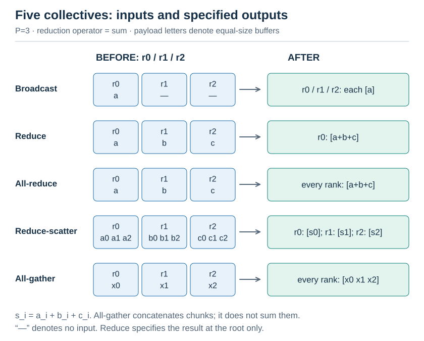
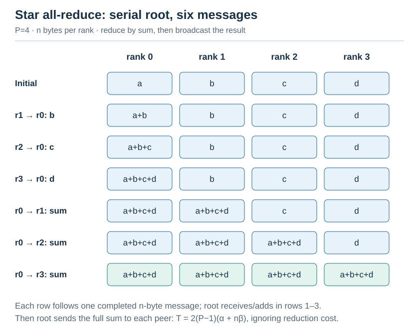
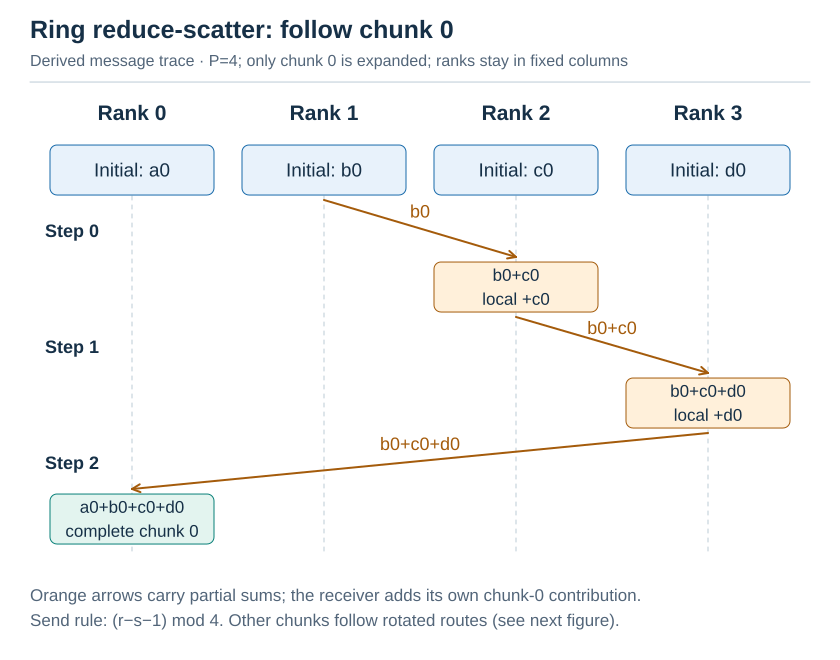
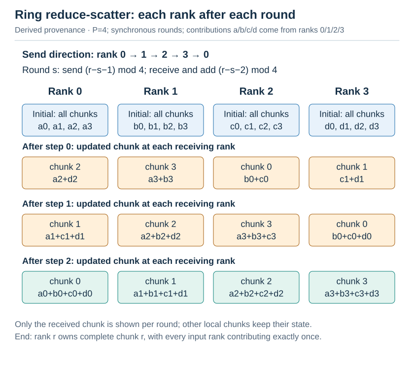
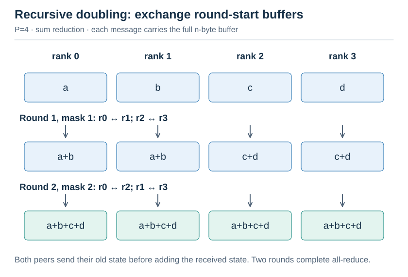
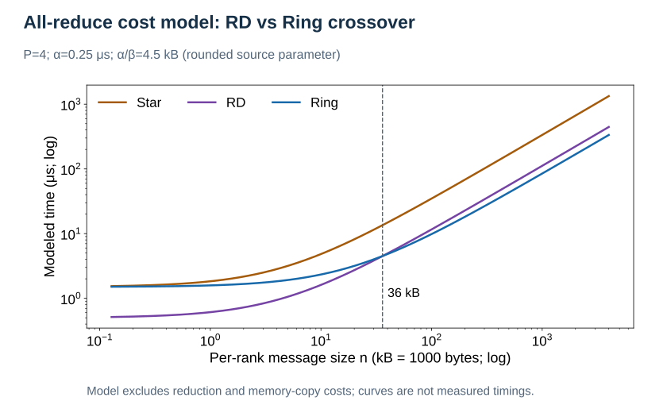
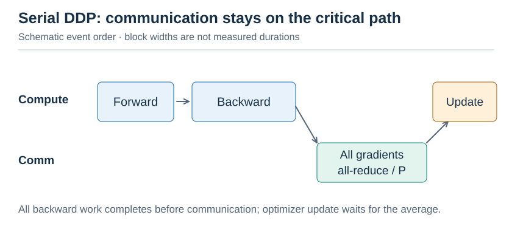
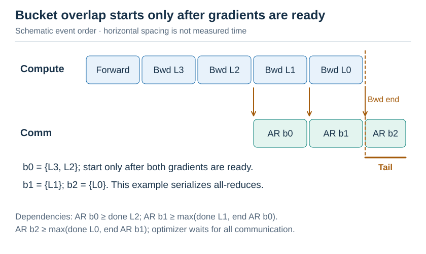
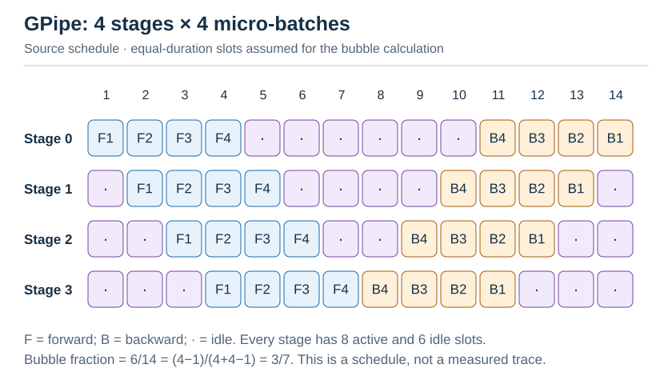

# L6 集合通信与并行训练

[← 课程大纲](../syllabus.md) · 上一讲：[L5 推测解码](L5-speculative.md) · 配套实验：[lab6](../../labs/lab6/README.md) · 下一讲：[L7 研究方法与研究项目](L7-research.md)

> [!abstract] 这一讲要解决的三个问题
>
> 1. **怎样高效地把 $P$ 份数据加起来？** ring、tree、recursive doubling 各适合什么场景？用什么模型判断？
> 2. **数据并行训练怎样把通信藏起来？** PyTorch DDP 的 bucket 和重叠是怎么回事？
> 3. **模型大到一张卡装不下时怎么办？** ZeRO、FSDP、张量并行、流水线并行各切的是什么，各付出了什么代价？苗老师组的 Galvatron 怎样自动选择组合？

| 节  | 内容                                             | 对应 lab    |
| --- | ------------------------------------------------ | ----------- |
| §1  | 集合通信原语与 $\alpha$-$\beta$ 模型             | Part A、B3  |
| §2  | allreduce 算法：star、ring、recursive doubling   | Part B      |
| §3  | 用模型选算法：交叉点                             | Part B 报告 |
| §4  | 数据并行：DDP 的 bucket 与重叠                   | Part C1     |
| §5  | 切分模型状态：ZeRO 1/2/3、FSDP                   | Part C2     |
| §6  | 张量并行、流水线并行、序列和上下文并行、专家并行 | 选读        |
| §7  | 演进脉络：自动并行、计算通信重叠、RL 训练系统    | 选题参考    |

---

## §1 集合通信原语与 $\alpha$-$\beta$ 模型

### 1.1 五个原语

图：五个集合通信原语（示意，不按耗时或容量比例）。

其中，$s_i = a_i + b_i + c_i$。关键恒等式是：

$$
\text{allreduce} = \text{reduce} + \text{broadcast}
$$

以及：

$$
\text{allreduce} = \text{reduce-scatter} + \text{all-gather}
$$

最后这个恒等式贯穿整讲：ring allreduce 和 ZeRO 都用到了它。

### 1.2 $\alpha$-$\beta$ 模型

点对点发送 $n$ 个字节的耗时：

$$
T(n) = \alpha + n\beta
$$

- **$\alpha$**（延迟）：建立一次通信的固定开销，包括软件栈、同步、网络往返；
- **$\beta$**（每字节时间）$= 1 / \text{带宽}$。

| 环境                                      | $\alpha$                               | $1/\beta$                                |
| ----------------------------------------- | -------------------------------------- | ---------------------------------------- |
| 同一台机器的进程间（lab6 实测，共享内存） | $\approx 0.25\,\mu\mathrm{s}$          | $\approx 19\,\mathrm{GB/s}$              |
| NVLink（H100）                            | 约几 $\mu\mathrm{s}$（含 kernel 启动） | $\approx 450\,\mathrm{GB/s}$（单向）     |
| InfiniBand 跨节点                         | $\approx (2\text{--}5)\,\mu\mathrm{s}$ | $\approx (25\text{--}50)\,\mathrm{GB/s}$ |

**半带宽消息大小** $n_{1/2} = \alpha/\beta$：消息比它小时，耗时主要是延迟；比它大时，主要是带宽。lab 中约为 4.5 KB。

归约还有计算开销 $\gamma$（每字节相加的时间），本讲的公式先忽略它。lab 实测，模型预测的耗时约为实测的 $1/2$ 到 $1/3$，$\gamma$ 和内存拷贝就是主要原因。

---

## §2 allreduce 算法

设 $P$ 个 rank、每个 rank 有 $n$ 字节。

### 2.1 star：先 reduce，再 broadcast

图：Star reduce 再 broadcast（按本节参数推导，非实测）。

共有 $2(P-1)$ 条消息，每条 $n$ 字节，都经过 rank 0：

$$
T = 2(P-1)(\alpha + n\beta)
$$

rank 0 的链路是瓶颈，$P$ 越大越慢。lab 实测：64 MB、$P=4$ 时比 ring 慢 2.4 倍。

### 2.2 ring：先 reduce-scatter，再 all-gather

把数据切成 $P$ 块。$P=4$ 时，reduce-scatter 需要三步。图中先列出全部初始数据，此后每一格只展示该 rank **当轮收到并累加的 chunk**；其他本地 chunk 保持原状态：

图：只追踪 chunk 0，橙色箭头表示实际消息：rank 1 的 b0 先送到 rank 2，加上 c0；再经 rank 3 加上 d0，最后送至 rank 0 加上 a0。各 rank 的列固定不变，其他 chunk 同时沿旋转后的路径传递。

图：与上图同一发送规则的完整轮次对照。初态列出全部本地 chunk；此后三行仅列各 rank 当轮收到并累加的 chunk，其他本地块保持状态。最终 rank r 得到完整 chunk r。

令 $s=0,1,2$，每步发送都读取轮初状态。rank $r$ 向右邻居 $(r+1)\bmod4$ 发送块 $(r-s-1)\bmod4$，从左邻居收到块 $(r-s-2)\bmod4$ 并累加到本地同号块。三步后，rank $r$ 得到完整 chunk $r$，其中每个 rank 的贡献恰好出现一次。

all-gather 再沿同方向转 $P-1$ 步，把每个完整块传给所有人。对于上述终态，重新令 $s=0,1,2$：rank $r$ 发送块 $(r-s)\bmod4$，收到块 $(r-s-1)\bmod4$；此阶段只复制，不再求和。

$$
T_{\text{ring}} = 2(P-1)\alpha + 2\frac{P-1}{P}n\beta
$$

**带宽项与 $P$ 几乎无关**：每个 rank 发送约 $2n$ 字节，无论 $P$ 有多大。这正是 ring 成为大消息默认算法的原因（[Baidu 2017](https://andrew.gibiansky.com/blog/machine-learning/baidu-allreduce/) 把它引入深度学习）。代价是延迟项随 $P$ 线性增长。

### 2.3 recursive doubling

P=4 时，每轮交换整个向量并相加：

| XOR mask | 配对 |
| --- | --- |
| 1 | rank 0 与 1；rank 2 与 3 |
| 2 | rank 0 与 2；rank 1 与 3 |

图：Recursive doubling 两轮（按本节参数推导，非实测）。

$$
T_{\mathrm{rd}} = \log_2 P \cdot (\alpha + n\beta)
$$

只需 $\log_2 P$ 步，延迟最低；但每一步都传输**整个**缓冲区，带宽项是 ring 的 $\log_2 P / 2$ 倍。

### 2.4 汇总

| 算法                               | 延迟项                           | 带宽项                  | 适合                       |
| ---------------------------------- | -------------------------------- | ----------------------- | -------------------------- |
| star                               | $2(P-1)\alpha$                   | $2(P-1)n\beta$          | 什么都不适合（只作基线）   |
| recursive doubling                 | $\log_2 P \cdot \alpha$          | $\log_2 P \cdot n\beta$ | 小消息                     |
| ring                               | $2(P-1)\alpha$                   | $\approx 2n\beta$       | 大消息                     |
| tree（NCCL 的 double binary tree） | $\approx 2\log_2 P \cdot \alpha$ | $\approx 2n\beta$       | 大规模集群上的中等大小消息 |

---

## §3 用模型选算法：交叉点

令 $T_{\mathrm{rd}} = T_{\mathrm{ring}}$，解出交叉点。$P=4$ 时：

$$
2\alpha + 2n\beta = 6\alpha + 1.5n\beta, \qquad n = 8\alpha/\beta \approx 8 \times 4.5\ \text{KB} \approx 36\ \text{KB}
$$

lab 实测：在 16 KB 处 RD 仍然更快（$8.4$ 对 $13.1\,\mu\mathrm{s}$），到 64 KB 时两者相当（$22$ 对 $21\,\mu\mathrm{s}$），到 256 KB 时 ring 明显更快。**模型给出了正确的量级**。

图：按原文约数 α=0.25 μs、α/β=4.5 kB 绘制的理论成本，P=4，交叉点为约 36 kB；忽略归约和内存复制成本，曲线不是实测。

这正是 MPI 库和 NCCL 内部做的事：按消息大小和 $P$ 选择算法。NCCL 的 `NCCL_ALGO` 环境变量可以强制指定算法（见 lab6 `hpc/README.md`）。

---

## §4 数据并行：DDP 的 bucket 与重叠

### 4.1 朴素的数据并行

每张卡持有一份完整的模型，处理不同的数据。反向传播结束后，对所有梯度做 allreduce 并取平均，然后各自更新：

图：串行 DDP 关键路径（示意，不按耗时或容量比例）。

通信完全暴露在关键路径上。

### 4.2 bucket + 重叠（[PyTorch DDP](https://arxiv.org/abs/2006.15704)，VLDB'20）

反向传播是**从最后一层往前**算的，后面层的梯度先就绪。把梯度分成若干个 **bucket**，只有全部成员的梯度都就绪后，该 bucket 才能启动 allreduce，同时反向传播继续往前算。图中 b0 包含 L3 与 L2，因此必须等 L2 也完成；b1 等 L1，b2 等 L0：

图：bucket 重叠的事件顺序示意。b0 要等 L3、L2 都就绪，b1 等 L1，b2 等 L0；本例通信串行，右端标出反向传播结束后仍未完成的通信。间距不代表耗时。

bucket 的大小是一个权衡：

- **太小**：每个 bucket 都要付一次 $\alpha$，次数多了延迟累积；
- **太大**：第一个 bucket 要等很久才凑齐，重叠的机会少。极端情况下只有一个 bucket，就退化成朴素做法。

PyTorch 的默认值是 25 MB。lab 实测（12 MB 梯度、4 层）：4 MB 的 bucket 把暴露的通信从 6.2 ms 降到 3.7 ms；16 MB 时只有一个 bucket，没有重叠。

> [!warning] 重叠需要“真正的并行”
> MPI 的非阻塞集合通信（`MPI_Iallreduce`）只有在程序调用 MPI 函数时才会推进（progress）。如果计算线程一直在算矩阵乘，通信其实没有进展。所以 lab 和 PyTorch 都用一个**单独的通信线程**（GPU 上则是单独的 CUDA stream，交给 NCCL）。

---

## §5 切分模型状态：ZeRO 与 FSDP

### 5.1 显存都花在哪里

用 Adam 和混合精度训练一个有 $\Psi$ 个参数的模型，每个参数要占用：

| 内容                           | 字节             |
| ------------------------------ | ---------------- |
| fp16 参数                      | 2                |
| fp16 梯度                      | 2                |
| fp32 主参数 + Adam 的 $m$、$v$ | $4 + 4 + 4 = 12$ |
| **合计**                       | **$16\Psi$**     |

7B 的模型需要 112 GB，单张 80 GB 的卡装不下。而数据并行时，$P$ 张卡上各存一份**完全相同**的状态，显存被白白浪费了 $P-1$ 份。

### 5.2 [ZeRO](https://arxiv.org/abs/1910.02054)（SC'20）：分片，而不是复制

| Method          | Params | Grads | Optimizer | Per-GPU bytes      | Extra communication                                                   |
| --------------- | ------ | ----- | --------- | ------------------ | --------------------------------------------------------------------- |
| DDP             | full   | full  | full      | $16\Psi$           | -                                                                     |
| ZeRO-1 (os)     | full   | full  | $1/P$     | $4\Psi + 12\Psi/P$ | none ($\operatorname{RS} + \operatorname{AG} = \text{one allreduce}$) |
| ZeRO-2 (os+g)   | full   | $1/P$ | $1/P$     | $2\Psi + 14\Psi/P$ | none                                                                  |
| ZeRO-3 (os+g+p) | $1/P$  | $1/P$ | $1/P$     | $16\Psi/P$         | all-gather params in fwd and bwd: $+50\%$                             |

ZeRO-1 的流程（lab C2）：

1. **reduce-scatter** 梯度：rank $r$ 只得到第 $r$ 块梯度的总和；
2. 只在第 $r$ 块上做 Adam 更新，$m$、$v$ 只需要 $1/P$ 的大小；
3. **all-gather** 参数，每个 rank 重新拿到完整的参数。

$\operatorname{RS} + \operatorname{AG}$ 正好等于一次 allreduce，所以**通信量没有增加**。lab 的意外发现：在 CPU 上，ZeRO-1 反而是最快的（15.3 对 23.1 ms），因为 Adam 的计算也被分成了 $1/P$。GPU 上的 Adam 很便宜，这个优势并不明显，ZeRO 的主要价值还是省显存。

### 5.3 [FSDP](https://arxiv.org/abs/2304.11277)（VLDB'23）

FSDP 是 PyTorch 对 ZeRO-3 的实现：按层（或按模块）分片参数，前向和反向用到某一层时才 all-gather 它的参数，用完就释放；反向传播之后用 reduce-scatter 得到分片的梯度。关键工程问题是**预取**：在计算第 $l$ 层时，提前 all-gather 第 $l+1$ 层的参数，把通信藏起来。

---

## §6 其他并行维度（选读）

| 并行方式                                                         | 切什么                              | 通信                                                            | 通信量                         | 通常放在                  |
| ---------------------------------------------------------------- | ----------------------------------- | --------------------------------------------------------------- | ------------------------------ | ------------------------- |
| 数据并行（DP/ZeRO/FSDP）                                         | 数据（以及状态）                    | 梯度 allreduce / $\operatorname{RS} + \operatorname{AG}$        | 每步 $\approx 2\Psi$           | 跨节点                    |
| 张量并行（[Megatron TP](https://arxiv.org/abs/1909.08053)）      | 每个矩阵按行或列切                  | 每层前向、反向各一次 allreduce                                  | 每层 $\approx \text{激活大小}$ | **节点内**（需要 NVLink） |
| 序列并行（[SP](https://arxiv.org/abs/2205.05198)）               | LayerNorm、Dropout 处的激活按序列切 | 把 TP 的 allreduce 拆成 $\operatorname{RS} + \operatorname{AG}$ | 与 TP 相同，激活显存减为 $1/P$ | 与 TP 一起                |
| 流水线并行（[PP](https://arxiv.org/abs/2104.04473)）             | 按层切成若干 stage                  | stage 之间点对点传激活                                          | 小                             | 跨节点                    |
| 上下文并行（[Ring Attention](https://arxiv.org/abs/2310.01889)） | 长序列按 token 切                   | KV 沿环传递，用 L2 §4 的 lse 合并                               | 每层 KV                        | 长上下文                  |
| 专家并行（EP，[DeepEP](https://github.com/deepseek-ai/DeepEP)）  | MoE 的专家分到不同的卡              | token 的 all-to-all                                             | 每层激活                       | MoE 模型                  |

流水线并行的“气泡”：

原示例的精确事件表如下：F 表示 forward，B 表示 backward，数字 1–4 是 micro-batch 编号；表内值是事件发生的逻辑步，未列出的步为空闲。

| stage | F1 | F2 | F3 | F4 | B4 | B3 | B2 | B1 |
| --- | --- | --- | --- | --- | --- | --- | --- | --- |
| 0 | 1 | 2 | 3 | 4 | 11 | 12 | 13 | 14 |
| 1 | 2 | 3 | 4 | 5 | 10 | 11 | 12 | 13 |
| 2 | 3 | 4 | 5 | 6 | 9 | 10 | 11 | 12 |
| 3 | 4 | 5 | 6 | 7 | 8 | 9 | 10 | 11 |

图：GPipe 四阶段四微批（按本节参数推导，非实测）。

气泡比例为：

$$
\text{bubble fraction} = \frac{p-1}{m+p-1}
$$

1F1B 的气泡比例相同，但需要的激活显存更少。

实际的大模型训练把 DP、TP、PP 组合成“3D 并行”（$\mathrm{DP} \times \mathrm{TP} \times \mathrm{PP}$），再加上 SP、CP、EP。

---

## §7 演进脉络

| 年份    | 工作                                                                                                                                                                                                               | 解决了上一步的什么问题                                                               |
| ------- | ------------------------------------------------------------------------------------------------------------------------------------------------------------------------------------------------------------------ | ------------------------------------------------------------------------------------ |
| 2005    | [Thakur et al.](https://web.cels.anl.gov/~thakur/papers/ijhpca-coll.pdf)（MPICH）                                                                                                                                  | 集合通信算法的 $\alpha$-$\beta$ 分析与按消息大小的选择                               |
| 2017    | [Baidu ring allreduce](https://andrew.gibiansky.com/blog/machine-learning/baidu-allreduce/)、Horovod                                                                                                               | 把 HPC 的 ring 引入深度学习                                                          |
| 2019    | [Megatron-LM](https://arxiv.org/abs/1909.08053)                                                                                                                                                                    | 张量并行：节点内切分 Transformer 层                                                  |
| 2020    | [ZeRO](https://arxiv.org/abs/1910.02054)（SC）、[PyTorch DDP](https://arxiv.org/abs/2006.15704)（VLDB）                                                                                                            | 状态分片；bucket 与重叠                                                              |
| 2021    | [PTD-P](https://arxiv.org/abs/2104.04473)（SC）                                                                                                                                                                    | DP、TP、PP 组合，交错式 1F1B 流水线                                                  |
| 2022    | [Alpa](https://arxiv.org/abs/2201.12023)（OSDI）                                                                                                                                                                   | 自动搜索算子内与算子间的并行方案                                                     |
| 2022    | **[Galvatron](https://arxiv.org/abs/2211.13878)**（VLDB'23，苗旭鹏等）、[Hetu](https://github.com/PKU-DAIR/Hetu)                                                                                                   | 对 Transformer 的每一层分别搜索 DP、SDP、TP、PP 的最优组合，用代价模型加动态规划     |
| 2023    | [FSDP](https://arxiv.org/abs/2304.11277)（VLDB）、[Ring Attention](https://arxiv.org/abs/2310.01889)、[DeepSpeed Ulysses](https://arxiv.org/abs/2309.14509)                                                        | 工程化的 ZeRO-3；长上下文的序列切分                                                  |
| 2024    | [FLUX](https://arxiv.org/abs/2406.06858)                                                                                                                                                                           | 把 TP 的通信融合进 GEMM kernel，实现细粒度的重叠                                     |
| 2025    | [Comet](https://arxiv.org/abs/2502.19811)（MLSys）、[DeepEP](https://github.com/deepseek-ai/DeepEP)、[DualPipe](https://github.com/deepseek-ai/DualPipe)                                                           | MoE 的专家并行通信与计算重叠；双向流水线                                             |
| 2024–25 | RL 训练系统：[OpenRLHF](https://arxiv.org/abs/2405.11143)、[HybridFlow / verl](https://arxiv.org/abs/2409.19256)（EuroSys'25）、[AReaL](https://arxiv.org/abs/2505.24298)、[slime](https://github.com/THUDM/slime) | rollout（推理）与训练交替，权重要在两种并行布局之间重新分片；异步 rollout 以掩盖长尾 |

### 研究问题种子

- **更好的 bucket 策略**：bucket 的划分能否根据实测的 $\alpha$、$\beta$ 和每层反向传播的耗时，用动态规划求出最优切分，而不用固定的 25 MB？
- **ZeRO-1 在 CPU 和 GPU 上的差异**：lab 发现，在 CPU 上，分片优化器计算本身就能带来收益。在 GPU 上，Adam 的耗时占 step 的比例是多少？什么样的模型和 batch 下，这个比例会变得重要？
- **异构集群的并行规划**：Galvatron 假设所有 GPU 相同。如果集群里混合了不同型号的 GPU 和不同带宽的链路（苗老师组 Helix 的推理场景），训练的并行方案应该怎样调整？

## 可视化资料汇总

| 资料                                                                                                                                                                   | 形式                                                    | 配合哪一节   |
| ---------------------------------------------------------------------------------------------------------------------------------------------------------------------- | ------------------------------------------------------- | ------------ |
| [HuggingFace Ultra-Scale Playbook](https://huggingface.co/spaces/nanotron/ultrascale-playbook)                                                                         | **交互式**，DP、ZeRO、TP、PP、CP、EP 的动画和显存计算器 | **全讲主线** |
| [Gibiansky: Baidu allreduce](https://andrew.gibiansky.com/blog/machine-learning/baidu-allreduce/)                                                                      | ring allreduce 的逐步图解                               | §2.2         |
| [JAX Scaling Book: sharding](https://jax-ml.github.io/scaling-book/sharding/) / [training](https://jax-ml.github.io/scaling-book/training/)                            | 带推导的切分与通信量分析                                | §5、§6       |
| [Simon Boehm: Data-parallel](https://siboehm.com/articles/22/data-parallel-training) / [Pipeline-parallel](https://siboehm.com/articles/22/pipeline-parallel-training) | bucket 与流水线气泡的图示                               | §4、§6       |
| [Lilian Weng: How to train really large models](https://lilianweng.github.io/posts/2021-09-25-train-large/)                                                            | 并行方式综述                                            | §6           |
| [picotron](https://github.com/huggingface/picotron)                                                                                                                    | 每种并行方式不到 300 行的教学实现                       | 对照阅读     |

## 自测清单

- [ ] 能画出五个集合通信原语，并说明 $\text{allreduce} = \text{reduce-scatter} + \text{all-gather}$
- [ ] 能写出 star、ring、RD 的 $\alpha$-$\beta$ 代价，并解释 ring 的带宽项为什么与 $P$ 无关
- [ ] 能用模型算出 ring 与 RD 的交叉点
- [ ] 能画出 DDP 的 bucket 重叠时间线，并说明 bucket 太大和太小的问题
- [ ] 能算出 Adam 混合精度训练时每个参数的字节数，以及 ZeRO 1/2/3 各省了多少
- [ ] 能说出 TP、PP、CP、EP 各切的是什么，通信发生在哪里，通常放在节点内还是跨节点
- [ ] 能用一句话说明 Galvatron 要解决的问题
